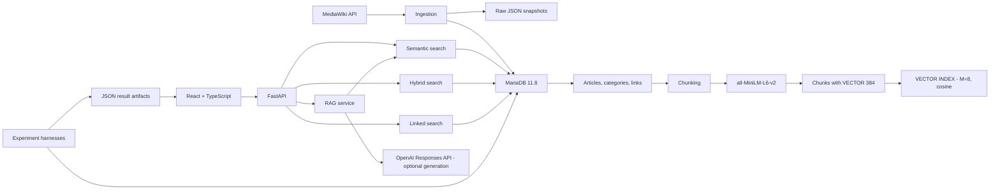
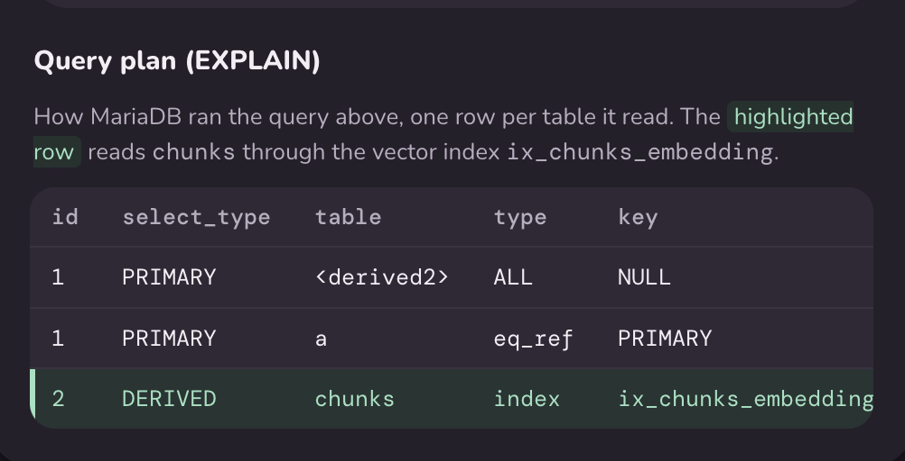
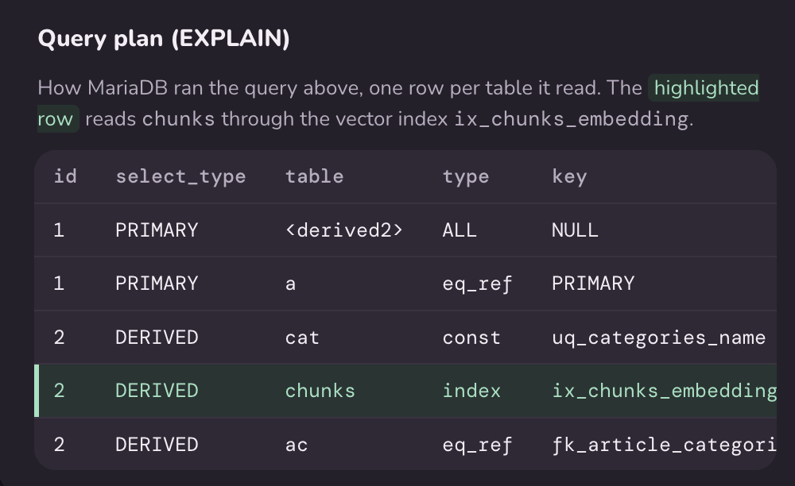
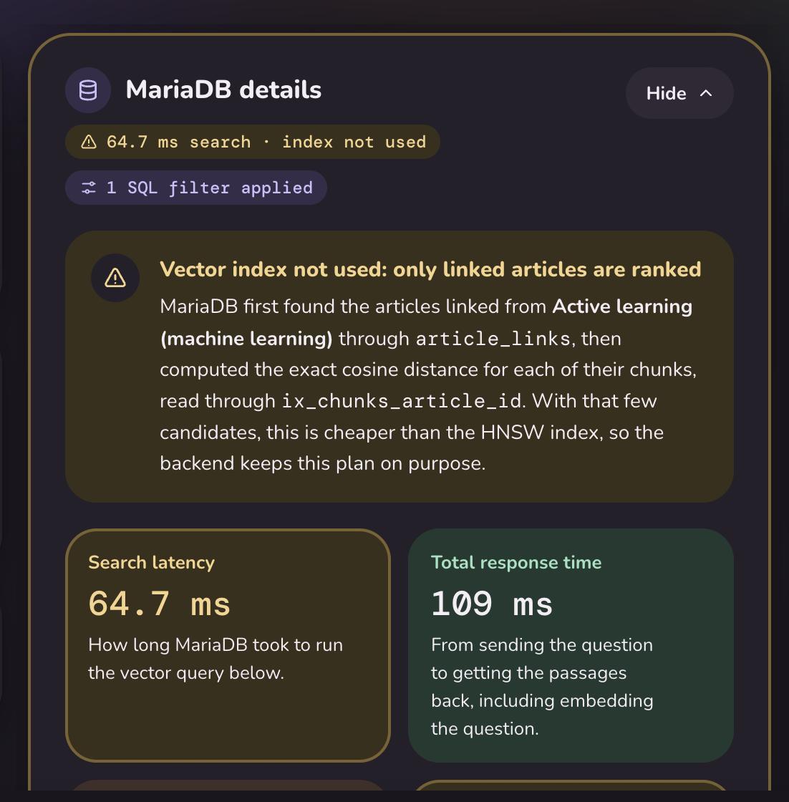
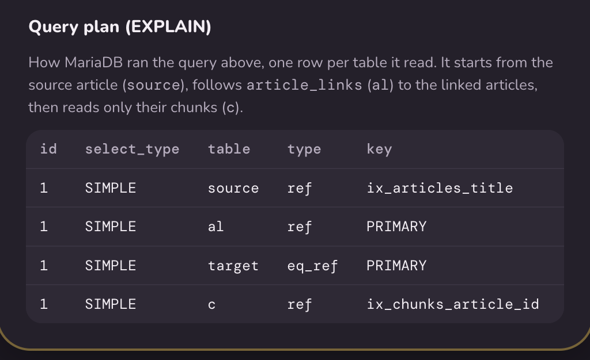
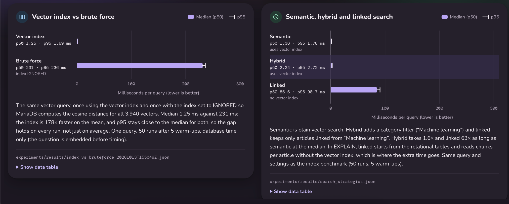

A project for area 4, "Vector search and RAG, natively" for the [MariaDB student database projects, 2026-09](https://mariadb.org/bachelor_hackathon_2026-09/).

# MVF — MariaDB Vector Finder

**MVF** is a full-stack MariaDB-native vector search and Retrieval-Augmented Generation (RAG) application over a reproducible Wikipedia corpus.

It keeps **vector storage, cosine similarity, ANN indexing, relational filtering, graph constraints, query planning, and retrieval diagnostics inside MariaDB**. A React frontend makes the database behavior visible: users can ask grounded questions, inspect retrieved chunks, run hybrid/category and linked-article searches, view the exact SQL, and inspect MariaDB `EXPLAIN` plans.


## Learn MariaDB vector search in five statements

The reusable core of MVF fits in five MariaDB statements. The full walkthrough is
in [`sql/examples.sql`](sql/examples.sql); these are the pieces to learn first:

```sql
-- 1. Store embeddings as a native vector type.
CREATE TABLE demo_chunks (
    id BIGINT PRIMARY KEY,
    category VARCHAR(64) NOT NULL,
    embedding VECTOR(384) NOT NULL
);

-- 2. Build MariaDB's native HNSW index for cosine distance.
CREATE VECTOR INDEX ix_demo_embedding
ON demo_chunks (embedding) M = 8 DISTANCE = cosine;

-- 3. Semantic ANN search.
SELECT id
FROM demo_chunks
ORDER BY VEC_DISTANCE_COSINE(embedding, VEC_FromText(:query_vector))
LIMIT 5;

-- 4. Hybrid search: ordinary SQL predicate and ANN ranking in one statement.
SELECT id, category
FROM demo_chunks
WHERE category = :category
ORDER BY VEC_DISTANCE_COSINE(embedding, VEC_FromText(:query_vector))
LIMIT 5;

-- 5. Tune the HNSW candidate pool for the current session.
SET SESSION mhnsw_ef_search = 200;
```

For a fresh checkout, **one command** restores the checked-in corpus, runs the
SQL walkthrough, and runs the guided retrieval demo:

```bash
make quickstart
```

No MediaWiki request, embedding-model download, or OpenAI key is required.

## Results at a glance

| Result | Current canonical measurement |
| --- | ---: |
| Corpus | **285 articles / 3,940 vectors** |
| Recall@10 | **92.5%** |
| MRR | **0.782** |
| 40-question semantic mean | **15.442 ms** |
| Native VECTOR INDEX vs brute force | **169.33×** |
| Filtered ANN speedup | **93.22×** |
| Backend pytest cases | **46 passed** |
| Frontend Vitest cases | **60 passed** |

For methodology, repeated passes, optimizer plans, variance and failure modes,
see [Measured results](#measured-results).

The **15.442 ms** ground-truth figure is intentionally a different workload from
the roughly **1.3 ms** semantic microbenchmarks below. Ground-truth evaluation
requests **200 candidate chunks per question** (`candidate_limit = 200`) so it can
de-duplicate chunk hits into up to ten unique articles before computing Recall@10.
The search-strategy and repeated multi-mode microbenchmarks request only
**5 rows (`LIMIT 5`)**. The larger candidate set, not contradictory measurements,
explains the order-of-magnitude latency difference.

### Contents

- [Results at a glance](#results-at-a-glance)
- [What the project demonstrates](#what-the-project-demonstrates)
- [Architecture](#architecture)
- [Data model](#data-model-and-why-it-is-shaped-this-way)
- [Retrieval modes](#retrieval-modes)
- [RAG user flow](#rag-user-flow)
- [Measured results](#measured-results)
- [Reproduce the project](#reproduce-the-project)
- [User guide](#user-guide)
- [Additional reproducibility probes](#additional-reproducibility-probes)
- [Concurrency, multi-mode and cross-machine verification](#concurrency-multi-mode-and-cross-machine-verification)
- [Testing and CI](#testing-and-ci)
- [Repository map](#repository-map)
- [Important findings and limitations](#important-findings-and-limitations)
- [Lessons and what we would change](#lessons-and-what-we-would-change)
- [Team](#team)
- [Why MariaDB for this project?](#why-mariadb-for-this-project)

### 10-minute MariaDB path

For the shortest reproducible path to the native-vector feature, run exactly:

```bash
make quickstart
```

That single target restores the checked-in relational corpus and all 3,940 stored
vectors, runs the pasteable MariaDB client walkthrough from `sql/examples.sql`,
and then runs the guided Python demo with ranked results, SQL, timings and
optimizer plans. No OpenAI key, MediaWiki call, or embedding-model download is
required. The equivalent individual steps remain available as
`make offline-bootstrap`, `make sql-demo`, and `make demo`.

### Why some development-run numbers changed

Earlier development snapshots reported different ANN measurements, including a
95% Recall@10 run and a lower single-query top-5 overlap for one rebuilt index.
Those values came from earlier index builds and experiment states. The repository
now keeps one current canonical result set, regenerated with the final harnesses
on the documented environment. ANN ordering near rank cutoffs can change after
index rebuilds, so committed JSON artifacts are treated as the source of truth
rather than assuming any one historical ANN run is invariant.

### Cross-machine validation

The final benchmark suite was also executed on a second environment through
GitHub Actions to check that the observed behavior is not specific to the local
Apple Silicon development machine.

| Environment | Semantic mean | Hybrid mean | Linked mean | Recall@10 under concurrent writes |
|---|---:|---:|---:|---:|
| Apple M4 Pro / macOS / arm64 / Python 3.13 | 1.292 ms | 2.610 ms | 86.949 ms | 92.5% → 92.5% → 92.5% |
| GitHub Actions / Ubuntu / x86_64 / Python 3.12.15 | 2.751 ms | 3.319 ms | 122.693 ms | 92.5% → 92.5% → 92.5% |

Both environments used **MariaDB 11.8.9**. Absolute latency differs across the
machines, especially for linked search, but retrieval behavior is stable:
all three workloads returned non-empty results for every measured query, and
the concurrent-writer stress test produced **zero write failures, zero query
failures, no Recall@10 degradation after inserts or cleanup, and zero orphan
chunks after cleanup**.

The Ubuntu benchmark artifacts are committed under
`experiments/results/ubuntu/` and include their own execution-environment
metadata. This provides an independent OS/architecture execution of the same
MariaDB-native vector workloads rather than relying on one developer laptop.

## What the project demonstrates

MVF directly exercises the Area 4 capability rather than treating MariaDB as a passive metadata store:

- native `VECTOR(384)` storage;
- native cosine `VECTOR INDEX`;
- `VEC_FromText(...)` and `VEC_DISTANCE_COSINE(...)`;
- semantic nearest-neighbor retrieval;
- vector search combined with ordinary relational predicates in the **same SQL statement**;
- graph-constrained retrieval through `article_links`;
- RAG over retrieved Wikipedia chunks;
- `EXPLAIN`, optimizer-statistics refresh, index-use visibility, and timing diagnostics;
- Recall@K / MRR evaluation, brute-force baselines, and vector-index parameter studies.

Current corpus:

| Metric                             |            Value |
| ---------------------------------- | ---------------: |
| Wikipedia articles                 |    **285** |
| Vector chunks                      |  **3,940** |
| Directed local article links       |  **2,710** |
| Embedding dimensions               |    **384** |
| Human-prepared retrieval questions |     **40** |
| MariaDB                            | **11.8.9** |

The embedding model is `sentence-transformers/all-MiniLM-L6-v2`; chunks are 220 model tokens with 40-token overlap and L2-normalized embeddings.

### Why this embedding model and corpus?

MVF uses `sentence-transformers/all-MiniLM-L6-v2` because it produces compact 384-dimensional sentence embeddings, runs locally without a hosted embedding API, and maps directly to MariaDB `VECTOR(384)`. That keeps ingestion reproducible and vector/index storage modest while still providing useful semantic retrieval quality for the project corpus.

The corpus is built reproducibly from the English Wikipedia `Machine learning` category through the MediaWiki API. Ingestion requests up to 300 pages (`make ingest`); the committed crawl produced **285 articles**, which are preserved as raw JSON snapshots under `data/raw/`. The project deliberately uses one coherent subject area so semantic, category-filtered, and article-link-constrained retrieval can be evaluated over the same relational corpus.

---

## Architecture



The application is deliberately layered:

- **React frontend**: query UX, filters, retrieved chunks, evaluation dashboards, SQL/plan visualization.
- **FastAPI backend**: HTTP contract and dependency wiring.
- **Services**: embedding, search, chunking, ingestion, RAG.
- **Repositories**: ordinary relational CRUD through SQLAlchemy.
- **Vector query module**: MariaDB-specific vector SQL centralized in `backend/app/db/queries/vector.py`.
- **MariaDB**: relational metadata, local link graph, vectors, ANN index, joins, ranking, filtering, and query planning.

Generation is intentionally separate from retrieval. With `OPENAI_API_KEY` configured, retrieved chunks are passed to the OpenAI Responses API for a grounded answer. Without an OpenAI key, the retrieval/search/evaluation functionality remains usable.

---

## Data model and why it is shaped this way

| Table                  | Purpose                                  | Design reason                                                                            |
| ---------------------- | ---------------------------------------- | ---------------------------------------------------------------------------------------- |
| `articles`           | Wikipedia metadata and source text       | one authoritative document row; avoids repeating metadata per vector                     |
| `categories`         | normalized category names                | supports indexed relational filtering                                                    |
| `article_categories` | article ↔ category relation             | makes hybrid retrieval a real SQL join/filter instead of post-filtering in Python        |
| `article_links`      | directed links inside the local corpus   | supports graph-constrained search entirely inside MariaDB                                |
| `chunks`             | retrievable text units + `VECTOR(384)` | keeps each embedding with the exact text it represents and avoids an extra hot-path join |

Each chunk has a deterministic `(article_id, chunk_index)` identity.

The vector column and index are native MariaDB objects:

```sql
embedding VECTOR(384) NOT NULL;
```

```sql
CREATE VECTOR INDEX IF NOT EXISTS ix_chunks_embedding
ON chunks (embedding)
M = 8
DISTANCE = cosine;
```

Relational metadata and vectors intentionally share one database so MariaDB can optimize mixed relational/vector workloads as a single query plan.

---

## Retrieval modes

### 1. Semantic vector search

The query is embedded in Python; MariaDB performs nearest-neighbor ranking:

```sql
SELECT
    c.chunk_id,
    c.article_id,
    a.title AS article_title,
    c.chunk_index,
    c.content,
    c.distance
FROM (
    SELECT
        id AS chunk_id,
        article_id,
        chunk_index,
        content,
        VEC_DISTANCE_COSINE(
            embedding,
            VEC_FromText(:embedding)
        ) AS distance
    FROM chunks
    ORDER BY distance ASC
    LIMIT :limit
) AS c
JOIN articles AS a ON a.id = c.article_id
ORDER BY c.distance ASC;
```

For the current corpus, `EXPLAIN` shows `ix_chunks_embedding` on `chunks`.



### 2. Hybrid search: vector + relational predicate

Hybrid search applies the category predicate **inside** the vector candidate query:

```sql
WHERE article_id IN (
    SELECT ac.article_id
    FROM article_categories AS ac
    JOIN categories AS cat
      ON cat.id = ac.category_id
    WHERE cat.name = :category
)
ORDER BY distance ASC
LIMIT :limit
```

This searches the correct filtered space instead of taking global top-k first and filtering afterward.


The UI exposes that the relational category index and the MariaDB vector index participate in the same plan:



### 3. Linked / graph-constrained search

Linked search starts from one Wikipedia article, follows `article_links`, reads only chunks belonging to linked target articles, and ranks those chunks by cosine distance.


This workload is intentionally **relational-first**. Controlled optimizer experiments showed that forcing a vector-first rewrite was not faster for the small graph-constrained candidate set. The production plan therefore uses relational indexes such as `ix_articles_title` and `ix_chunks_article_id` instead of forcing HNSW.





This is an important project finding: **the vector index is not automatically the cheapest plan for every vector-bearing query**.

---

## RAG user flow

1. User asks a question in the React UI.
2. `EmbeddingService` creates a 384-dimensional query vector.
3. MariaDB retrieves the closest Wikipedia chunks with native vector SQL.
4. The backend returns the chunks, SQL, timings, and `EXPLAIN` diagnostics.
5. If OpenAI generation is configured, only the retrieved context is sent to the generator.
6. The UI shows the grounded answer, citations, source articles, chunk distances, and MariaDB details.

The frontend distinguishes database retrieval time from full RAG response time, so LLM latency is not confused with MariaDB search latency.

---

## Measured results

Benchmarks isolate **database retrieval**: query embedding is computed before timing, then the same embedding is reused. The main latency harness uses **5 warm-up executions + 50 measured executions** and records mean, median, P95, and machine-readable JSON results.

### Search strategies

| Strategy |               Mean |    Median |       P95 | Main retrieval index     |
| -------- | -----------------: | --------: | --------: | ------------------------ |
| Semantic | **1.385 ms** | 1.316 ms | 1.765 ms | `ix_chunks_embedding` |
| Hybrid   | **2.230 ms** | 2.173 ms | 2.607 ms | `ix_chunks_embedding` |
| Linked   | **89.302 ms** | 89.154 ms | 91.032 ms | `ix_chunks_article_id` |

Latency scope: all three strategy microbenchmarks use **`LIMIT 5`**.

### Native index vs brute force

| Mode                      |               Mean |        P95 |
| ------------------------- | -----------------: | ---------: |
| MariaDB `VECTOR INDEX` | **1.392 ms** | **1.836 ms** |
| Brute-force cosine search | 235.715 ms | 237.491 ms |

Observed mean speedup: **169.33×**. Both modes use the same **`LIMIT 5`** query.



### Retrieval quality

Current ANN evaluation over 40 manually prepared questions:

| Metric    |           Result |
| --------- | ---------------: |
| Recall@1  |  **67.5%** |
| Recall@3  |  **87.5%** |
| Recall@5  |  **87.5%** |
| Recall@10 |  **92.5%** |
| MRR       |  **0.782** |
| Misses@10 | **3 / 40** |

Ground truth is stored in `data/ground_truth/questions.jsonl`.

MVF also runs an exhaustive article-level reference evaluation. In the current canonical run, both the ANN evaluation and the exhaustive article-level evaluation measured **92.5% Recall@10 / 0.782 MRR / 3 misses**. They remain separate harnesses because ANN and exact ranking are different retrieval paths and may diverge near rank cutoffs after future index rebuilds or corpus changes.

### Vector-index `M` study

Each `M` value is rebuilt from scratch, warmed up over the full 40-question
ground-truth set, and then measured for **3 complete passes**. Every question
requests **`candidate_limit = 200`** chunks before article-level de-duplication.

| M | Build time | Mean query | Median query | P95 query | Between-pass stddev | Recall@10 | MRR |
|---:|---:|---:|---:|---:|---:|---:|---:|
| 4 | 168.898 ms | 15.429 ms | 15.417 ms | 16.675 ms | 0.110 ms | 92.5% | 0.782 |
| **8** | **341.078 ms** | **15.686 ms** | **15.534 ms** | **17.669 ms** | **0.012 ms** | **92.5%** | **0.782** |
| 16 | 1.035 s | 15.736 ms | 15.681 ms | 17.079 ms | 0.113 ms | 92.5% | 0.782 |
| 32 | 3.850 s | 16.706 ms | 15.827 ms | 18.525 ms | 1.327 ms | 92.5% | 0.782 |

`M=8` remains the production choice. All tested values produced the same
article-level Recall@10 and MRR, while higher values substantially increased
index-build cost. The three-pass measurements also expose run-to-run latency
variation instead of relying on one measured ground-truth pass.

A separate single-query exact-top-5 probe gives another view of approximation
behavior:

| M | Build time | Mean query | P95 query | Exact top-5 overlap |
|---:|---:|---:|---:|---:|
| 4 | 162.753 ms | 1.047 ms | 1.276 ms | 80% |
| 8 | 332.477 ms | 1.099 ms | 1.349 ms | 80% |
| 16 | 1.039 s | 1.227 ms | 1.435 ms | 100% |
| 32 | 3.883 s | 1.215 ms | 1.478 ms | 100% |

For this query, larger `M` improved exact top-k agreement, but at a much larger
index-build cost and with no improvement in the full 40-question article-level
Recall@10. The project therefore reports both the single-query chunk-level
probe and the full ground-truth evaluation instead of treating either one as
universally representative.

Artifacts:

- `experiments/results/vector_index_m_ground_truth_20261018T112918Z.json`
- `experiments/results/vector_index_m_sweep_20261018T113131Z.json`

### Filtered ANN probe

MVF also measures the category-filtered hybrid query with the native vector index enabled and optimizer-ignored, using the same query, category and top-k in both cases. Both modes use **`LIMIT 5`**.

| Hybrid mode | Mean latency | Top-k |
|---|---:|---|
| `ix_chunks_embedding` enabled | **2.497 ms** | reference |
| Vector index optimizer-ignored | 232.818 ms | identical |

Observed mean speedup: **93.22×**, with the **same top-k** in both runs.

This directly verifies that the relational category predicate can coexist with native ANN retrieval in the same SQL statement and that the vector index is materially responsible for the measured hybrid-search speedup.

Result artifact:

```text
experiments/results/hybrid_index_probe_20261018T111312Z.json
```

### Highly selective filtered-ANN limit probe

The broad `Machine learning` category above is the happy path, so MVF also has a
separate failure-mode probe for **highly selective relational predicates**.
`make selective-filter` discovers real Wikipedia categories with at least
`LIMIT 10` eligible chunks but at most 50 matching chunks in the 3,940-vector
corpus, then runs the same category predicate with MariaDB ANN at
`mhnsw_ef_search = 20 / 200 / 800` and with `ix_chunks_embedding` optimizer-ignored
as an exact filtered baseline. Because every chosen category has at least ten
eligible chunks, an indexed result with fewer than ten rows is genuine ANN/filter
underfill rather than a category that simply has too little data.

The probe records returned-row count, predicate selectivity, repeated mean/P95
latency, exact-top-k overlap, and `EXPLAIN` plans for each setting. It always
restores the vector index in a `finally` block. The committed machine-generated
report and JSON artifact are:

- [`docs/selective-filter-results.md`](docs/selective-filter-results.md)
- the timestamped `experiments/results/selective_filter_probe_*.json` named by that report

This experiment is deliberately framed as a **limit/failure-mode test**, not as a
claim that every selective predicate must underfill: the report states whether
underfill was reproduced on this corpus and whether increasing the ANN candidate
pool changed the result.

### Runtime HNSW `mhnsw_ef_search` study

MVF also evaluates MariaDB's session-level `mhnsw_ef_search`, complementing
the build-time `M` study. Each setting uses the complete 40-question
ground-truth set with one warm-up round and **3 complete measured passes**.
Every query requests **`candidate_limit = 200`** chunks, matching the full
ground-truth latency workload.

The table below is generated from the committed result artifact; aggregate
P95 and between-pass standard deviation are therefore the exact values stored
in the JSON rather than manually copied measurements.

| `mhnsw_ef_search` | Aggregate mean | Aggregate P95 | Between-pass stddev | Recall@10 | MRR |
|---:|---:|---:|---:|---:|---:|
| 200 | 15.523 ms | 17.069 ms | 0.363 ms | 92.5% | 0.782 |
| 400 | 16.088 ms | 17.483 ms | 0.123 ms | 92.5% | 0.782 |
| 800 | 15.834 ms | 17.257 ms | 0.228 ms | 92.5% | 0.782 |
| 1600 | 16.993 ms | 18.117 ms | 1.383 ms | 92.5% | 0.782 |

On this 3,940-vector corpus, raising `mhnsw_ef_search` above 200 did not improve
Recall@10 or MRR. The higher settings therefore increased search effort without
a quality benefit on this workload.

Artifact:

`experiments/results/vector_ef_search_20261018T111327Z.json`

### Multi-query ground-truth latency

The single-query microbenchmarks are complemented by a workload that times the
**entire 40-question ground-truth set**. Query embeddings are precomputed before
timing. One complete warm-up pass is followed by **5 measured passes**, for
**200 measured semantic-search queries** in total. Each query requests
**`candidate_limit = 200`** chunks before article-level de-duplication.

| Metric | Result |
|---|---:|
| Mean | **15.442 ms** |
| Median | **15.366 ms** |
| P95 | **17.454 ms** |
| Between-pass mean stddev | **0.205 ms** |
| Recall@10 | **92.5%** |
| MRR | **0.782** |

This workload provides query diversity and repeated whole-workload measurements
rather than using one query as the only latency evidence.

Artifact:

`experiments/results/ground_truth_latency_20261018T112857Z.json`

### Transaction and vector-index lifecycle

A controlled MariaDB lifecycle probe exercises a real relational row and its
`VECTOR(384)` chunk across transaction boundaries:

- a second session cannot observe the uncommitted row;
- after commit, a fresh session sees the relational row;
- native vector search finds the newly committed vector;
- deleting the parent article removes the chunk through the relational cascade;
- a fresh session confirms that neither row remains.

| Check | Current result |
|---|---:|
| Uncommitted row visible to second session | **No** |
| Row visible after commit | **Yes** |
| Vector search finds row after commit | **Yes** |
| Article rows after delete | **0** |
| Chunk rows after cascade delete | **0** |
| Insert + index commit | **0.955 ms** |
| Delete + index commit | **2.919 ms** |

This complements the rollback integration test with commit visibility, isolation,
ANN visibility of a newly committed vector, delete behavior, and index-maintenance
cost.

Artifact:

`experiments/results/vector_lifecycle_20261018T112923Z.json`

### Repeated multi-mode workload

A separate workload runs **semantic, hybrid, and linked retrieval over all 40
ground-truth questions**, with one warm-up pass and **5 measured passes** per
mode (**200 measured queries per mode**). These repeated mode comparisons use
**`LIMIT 5`** for semantic, hybrid, and linked retrieval.

| Environment | Mode | Mean | P95 | Between-pass stddev | Non-empty result rate |
|---|---|---:|---:|---:|---:|
| Apple M4 Pro / macOS | Semantic | **1.292 ms** | 1.490 ms | 0.146 ms | 100% |
| Apple M4 Pro / macOS | Hybrid | **2.610 ms** | 3.164 ms | 0.459 ms | 100% |
| Apple M4 Pro / macOS | Linked | **86.949 ms** | 88.778 ms | 0.408 ms | 100% |
| GitHub Actions / Ubuntu | Semantic | **2.751 ms** | 1.976 ms | 2.930 ms | 100% |
| GitHub Actions / Ubuntu | Hybrid | **3.319 ms** | 5.593 ms | 0.714 ms | 100% |
| GitHub Actions / Ubuntu | Linked | **122.693 ms** | 127.200 ms | 1.185 ms | 100% |

This removes the earlier single-query limitation for all three retrieval modes
and also shows how absolute latency changes across different hardware/OS
environments while the query behavior remains consistent.

Artifacts:

- `experiments/results/multi_mode_latency_20261018T115413Z.json`
- `experiments/results/ubuntu/multi_mode_latency_20261018T162532Z.json`

### Concurrent writers and ANN stability

The concurrency harness uses **2 independent writer sessions** inserting
**50 vector-bearing rows total** while a third session executes **50 semantic
queries**. Retrieval quality is measured before inserts, after inserts, and
after deleting the probe rows.

| Environment | Write failures | Query failures | Commit mean | Commit P95 | Recall@10 baseline → insert → cleanup | Orphan chunks |
|---|---:|---:|---:|---:|---:|---:|
| Apple M4 Pro / macOS | **0** | **0** | 0.934 ms | 1.279 ms | **92.5% → 92.5% → 92.5%** | **0** |
| GitHub Actions / Ubuntu | **0** | **0** | 1.261 ms | 2.274 ms | **92.5% → 92.5% → 92.5%** | **0** |

MRR remained **0.782** on the Ubuntu baseline, post-insert, and post-delete
checks, with **3 misses@10** in each state. The measured Recall@10 delta after
both insert and cleanup was exactly **0.0**.

Artifacts:

- `experiments/results/vector_concurrency_20261018T115420Z.json`
- `experiments/results/ubuntu/vector_concurrency_20261018T162542Z.json`

Machine-readable results live in `experiments/results/`.

> **Benchmark provenance:** older development benchmark JSON predates environment capture, so those historical absolute latencies should be treated as hardware-dependent. Current experiment artifacts record the execution environment automatically. The canonical local studies were run on **Darwin 24.5.0 / arm64**, **Python 3.13.0**, with **MariaDB 11.8.9-MariaDB-ubu2404** in Docker; the final multi-mode and concurrency studies were also repeated on **Linux 6.17 / x86_64**, **Python 3.12.15**, with the same MariaDB 11.8.9 server version in GitHub Actions. The harness fixes corpus size, query set, warm-ups, measured passes, distance metric and index configuration.

`make environment` records OS, architecture, processor, Python and MariaDB version and, when available, machine/VM model, CPU/chip and memory on both macOS and Linux. The GitHub Actions cache-sweep artifact therefore carries runner hardware metadata instead of leaving those fields null.

The exact timestamp of the original Wikipedia crawl was not recorded, so `data/manifest.json` intentionally keeps `retrieved_at: null` instead of inventing a date. Future ingestion runs should record the timestamp at collection time.

---

## Reproduce the project

### Requirements

- Python **3.12+**
- Docker + Docker Compose
- Node.js **22+**
- MariaDB is provided by Docker (`mariadb:11.8`)
- optional: `OPENAI_API_KEY` for generated RAG answers

Local services bind to loopback by default. MariaDB uses a separate `DB_ROOT_PASSWORD`, and `make api` runs without hot reload; `make api-dev` is available for local code-reload development.

The first vector build downloads `sentence-transformers/all-MiniLM-L6-v2` if it is not already cached.

### 1. Backend and MariaDB

```bash
python3 -m venv .venv
source .venv/bin/activate
make install-dev

cp .env.example .env

make db-up
make db-init
make db-verify
```

Expected verification includes MariaDB 11.8, the five project tables, and `vector(384)` for `chunks.embedding`.

### 2. Build the reproducible Wikipedia corpus

```bash
make ingest
make index
```

The ingestion uses the MediaWiki API and preserves raw snapshots under `data/raw/`. Ingestion and vector indexing are deliberately separate, so embeddings can be rebuilt without downloading the corpus again.

### 3. Run the API

```bash
make api
```

- API: `http://localhost:8000`
- OpenAPI: `http://localhost:8000/docs`
- health: `GET /health`
- live project metadata: `GET /api/stats`

### 4. Run the frontend

```bash
cd frontend
cp .env.example .env
npm ci
npm run dev
```

`frontend/.env.example` already points `VITE_API_URL` at `http://localhost:8000`; set `VITE_USE_MOCK=true` if you want to explore the UI without a running backend.

Open the Vite URL (normally `http://localhost:5173`).

### Fast MariaDB-only demonstration

Once the database is prepared:

```bash
make demo
```

This runs semantic, hybrid, and linked retrieval and prints ranked results, the exact MariaDB SQL, parameters, timings, `EXPLAIN`, and selected indexes.

Machine-readable output:

```bash
python3 -m scripts.demo --json
```

No OpenAI key is required for this retrieval demo.

### One-command first-time bootstrap

For a fresh checkout, the complete local data/retrieval setup can also be prepared with:

```bash
make bootstrap
```

This creates missing backend/frontend environment files from the checked-in examples, installs Python and frontend development dependencies, starts and waits for MariaDB, applies the schema, ingests the Wikipedia corpus, and builds the vector index. It intentionally does not start long-running API/frontend processes; run `make api` and `make frontend` in separate terminals afterwards.

### Offline full-corpus restore

The repository supports a portable prebuilt corpus snapshot that contains the
relational rows, link graph and all 3,940 stored vectors. The checked-in `data/prebuilt/mvf_corpus.json.gz` lets a newcomer restore the full
corpus **without calling MediaWiki and without downloading the embedding model**:

```bash
make offline-bootstrap
```

The snapshot is produced from the canonical local database with:

```bash
make prebuilt-export
```

The restore command is deliberately destructive only after two safeguards: the
caller must pass an explicit reset acknowledgement and the connected database
name must match the expected `DB_NAME`. `make offline-bootstrap` supplies both
checks. `tests/integration/test_prebuilt_roundtrip.py` also exports the active
corpus, restores it, and verifies all five table counts as a real round trip.

For readers who want the corpus **without any project Python tooling**, the same
checked-in data is also available as `data/prebuilt/mvf_corpus.sql.gz`.
`make prebuilt-sql-export` regenerates it with MariaDB's own `mariadb-dump`
client (`--single-transaction --hex-blob`), exercising the normal backup/export
path for tables that contain a native `VECTOR INDEX`. After applying the two
schema files, it can be loaded by a normal MariaDB client:

```bash
gzip -dc data/prebuilt/mvf_corpus.sql.gz | \
  mariadb -h 127.0.0.1 -u mvf -p mvf
```

`make sql-demo` restores the JSON snapshot and executes the complete
`sql/examples.sql` walkthrough, including `VECTOR`, `VECTOR INDEX`, hybrid and
graph predicates, `EXPLAIN`, and `mhnsw_ef_search`. Docker itself must of course
already be available locally.

### Standalone SQL examples

[`sql/examples.sql`](sql/examples.sql) is a MariaDB-client walkthrough independent of the Python API. It uses an existing stored chunk as the query vector so the semantic, category-filtered, linked-article, relational-predicate, `EXPLAIN`, and `mhnsw_ef_search` examples can be pasted directly into a prepared MVF database. The temporal example explicitly uses MVF row-maintenance time (`articles.updated_at`) and does not claim that this is a Wikipedia revision timestamp.

When reading the included `EXPLAIN` output, look for `ix_chunks_embedding` on the `chunks` row for semantic/hybrid ANN retrieval, `uq_categories_name` on the category side of the hybrid plan, and `ix_chunks_article_id` in linked search, where the relational-first plan is intentionally cheaper than forcing HNSW.

A captured MariaDB 11.8.9 run is checked in at [`docs/sql-demo-output.txt`](docs/sql-demo-output.txt). It lets a reader inspect representative result rows and plans even without Docker or Python installed.

### Transactional consistency

MariaDB stores the relational article and its vector chunk in the same InnoDB transaction. `tests/integration/test_vector_transaction.py` inserts an article plus `VECTOR(384)` chunk, verifies both are visible inside the transaction, rolls the transaction back, and then verifies that neither row remains. This demonstrates the database-native consistency advantage over synchronizing a relational database with a separate vector service.

---

## User guide

**Ask**
Type a question and press **Ask**. With OpenAI configured, MVF shows the generated grounded answer, Wikipedia sources, retrieved chunks, cosine distance/similarity, and MariaDB diagnostics.

**Hybrid filter**
Open **Filters**, choose a category such as `Machine learning`, apply it, and run the query. MVF deliberately shows retrieval-only results so the relational/vector behavior is easy to inspect.

**Linked filter**
Choose **Linked from article**. MariaDB follows the local `article_links` graph and ranks only chunks belonging to linked target articles.

**MariaDB details**
Expand the details card to inspect search latency, index use, exact SQL, highlighted filter lines, and `EXPLAIN`.

**Evaluation**
Open **Evaluation** to inspect committed Recall@K/MRR, indexed-vs-brute-force latency, semantic/hybrid/linked timings, and the `M` parameter study.

---

## Additional reproducibility probes

```bash
make environment
make ef-search
make hybrid-index
make selective-filter
make ground-truth-latency
make m-ground-truth
make vector-lifecycle
make multi-mode-latency
make vector-concurrency
make vector-scale
make vector-cache-sweep
```

`make environment` prints machine-readable host and MariaDB metadata. `make ef-search` evaluates MariaDB's session-level `mhnsw_ef_search` tuning surface at 200/400/800/1600 candidates over the complete 40-question ground-truth set, with three complete measured passes per setting and latency variance, then restores the production/default value (20). The current run found identical **92.5% Recall@10 / 0.782 MRR** at every setting, while aggregate mean latency rose from **15.523 ms** at 200 to **16.993 ms** at 1600. `make hybrid-index` measures the category-filtered query with `ix_chunks_embedding` enabled and optimizer-ignored; the current run measured **2.497 ms vs 232.818 ms (93.22×)** with identical top-k. `make selective-filter` deliberately searches rare real categories with enough eligible rows to satisfy `LIMIT 10`, then compares indexed ANN at several `mhnsw_ef_search` settings with an index-ignored exact baseline to detect filtered-ANN underfill and approximation under selective predicates. `make ground-truth-latency` removes the single-query benchmark limitation by timing all **40 ground-truth questions across 5 measured passes (200 measured queries)** after a complete warm-up pass, preserving per-query timings and per-pass summaries. `make m-ground-truth` evaluates each `M` value with **3 complete measured ground-truth passes** rather than one. `make vector-lifecycle` checks second-session isolation before commit, ANN visibility after commit, and vector/index cleanup after cascade delete while recording insert/delete commit cost.

`make vector-scale` isolates server/index scaling from retrieval quality. It builds a scratch table at **1×, 5×, 10× and 25×** the canonical corpus, rebuilds the production `M=8` cosine vector index at each size, records build time, query mean/P95, raw vector payload, and the server's configured `mhnsw_max_cache_size`, then drops the scratch table. MariaDB 11.8 does not expose a reliable per-index resident-memory figure through the metadata path used by this harness, so ordinary `information_schema.TABLES.INDEX_LENGTH` is deliberately **not** presented as HNSW memory. The command writes a timestamped JSON artifact plus `docs/vector-scale-results.md`; the repeated vectors make this a controlled index-cost probe rather than a new Recall/MRR claim.

The current measured values are kept in [`docs/vector-scale-results.md`](docs/vector-scale-results.md), which is generated from the same run that writes the timestamped JSON artifact. The README deliberately does not duplicate those scale numbers so the prose cannot drift from the committed machine-readable result. This is an operational scaling result, not a recall claim.

`make vector-cache-sweep` goes one step further with a **25× / 98,500-vector** scratch workload under multiple GLOBAL `mhnsw_max_cache_size` limits (4, 16 and 64 MiB by default). Unlike the simpler scale probe, the cache study removes exact duplicates: every copied vector receives a tiny deterministic two-coordinate rotation that preserves its L2 norm. It embeds **20 real ground-truth questions**, performs **3 independent HNSW rebuilds per cache setting**, and reports build mean/stddev/min/max plus multi-query mean/P95 latency. ANN variability is now summarized with a **within-setting pairwise top-5 overlap** that compares only distinct rebuild pairs, so no rebuild is ever compared with itself. A separate across-cache table compares the first rebuild from each setting against the first setting's first rebuild and is explicitly kept separate from the within-setting statistic. The original server cache value is restored in a `finally` block.

The curated cross-machine comparison is kept in [`docs/vector-cache-sweep-results.md`](docs/vector-cache-sweep-results.md). Each new `make vector-cache-sweep` run also writes a generated single-run summary to `experiments/results/vector-cache-sweep-latest.md` locally, or `experiments/results/ubuntu/vector-cache-sweep-results.md` in GitHub Actions; the generated file is intentionally separate so CI cannot overwrite the curated two-machine document.

The committed repeated-build study is interpreted as a **server-limit experiment, not a relevance claim**: cache size is compared primarily through repeated index-build cost and variance, while query latency is measured over the same 20 real questions. Exact duplicate ties have been removed, so residual top-5 differences are treated as ANN rebuild variability rather than evidence that a larger cache deterministically changes retrieval quality. Across-cache overlap is descriptive only because changing the cache setting also requires a fresh ANN rebuild. The curated two-machine comparison lives in [`docs/vector-cache-sweep-results.md`](docs/vector-cache-sweep-results.md); machine-readable source data remains in the timestamped JSON artifacts.

The same repeated cache-sweep workload was executed on **GitHub Actions Ubuntu/x86_64**. The current committed second-machine artifact is [`experiments/results/ubuntu/vector_cache_sweep_20261018T163108Z.json`](experiments/results/ubuntu/vector_cache_sweep_20261018T163108Z.json). In that run, mean build time decreased from **37.023 s** at 4 MiB to **29.556 s** at 16 MiB and **19.550 s** at 64 MiB. Mean query latency was **0.523 / 0.377 / 0.373 ms**, and within-setting pairwise top-5 overlap was **59.0% / 61.3% / 66.3%** for 4 / 16 / 64 MiB. The macOS overlap was **75.0% / 67.7% / 71.3%**, so ranking variation does not follow one cache-dependent pattern across machines and is treated as ANN rebuild variability.

Independent GitHub-hosted Ubuntu runs showed noticeable absolute timing drift on the shared runner while preserving the same qualitative cache-size trend. These CI measurements are therefore used to reproduce behavior and directionality rather than as hardware-normalized latency comparisons. Because `mhnsw_max_cache_size` is GLOBAL, the local target requires `DB_ROOT_PASSWORD`; the password is supplied through the environment rather than embedded in source.

---

## Concurrency, multi-mode and cross-machine verification

Two additional harnesses target the remaining operational limits of native
vector retrieval:

- `make multi-mode-latency` runs **semantic, hybrid and linked retrieval** across
  all 40 ground-truth questions for 5 measured passes after warm-up. This avoids
  using one query as the only latency workload for any retrieval mode.
- `make vector-concurrency` uses **two concurrent writer sessions** while a third
  session performs semantic reads, then compares Recall@10 before inserts, after
  inserts, and after cleanup. It records write/query failures, commit-latency
  distribution and verifies that cascade cleanup leaves no orphan chunks.

The `.github/workflows/benchmark.yml` workflow restores the checked-in prebuilt
corpus on an **Ubuntu GitHub Actions runner**, executes the multi-mode,
concurrency, and repeated cache-sweep harnesses, and uploads only artifacts
generated in that runner. It can be dispatched manually and also runs weekly, so
benchmark regressions are checked continuously rather than only on demand. The
current repository includes the resulting Ubuntu artifacts under
`experiments/results/ubuntu/`, including
`vector_cache_sweep_20261018T163108Z.json`, whose environment metadata records
the runner VM, AMD EPYC CPU and 15.61 GiB RAM. This gives a second
OS/architecture result set beside the macOS / Apple M4 Pro measurements rather
than treating one laptop as universal.

## Testing and CI

Backend quality gate:

```bash
make quality
```

It runs Ruff, formatting checks, strict mypy, and pytest. In the verified local quality run, pytest **collected and passed 46 test cases**. CI additionally loads `data/prebuilt/mvf_corpus.sql.gz` into a fresh scratch database using the stock `mariadb` client, verifies the five canonical table counts, and drops the scratch database again; this exercises the client-only SQL restore path independently of the Python JSON restore. This is the pytest collected-case count (including parametrized cases), not a count of `def test_...` source functions. Coverage includes API integration, semantic/hybrid/linked retrieval, RAG behavior, chunking, embedding behavior, transactional vector rollback, the prebuilt export/restore round trip, destructive-restore safeguards, an explicit committed `VECTOR(384)` UPDATE probe **before and after HNSW rebuild**, deterministic norm-preserving cache-sweep perturbations, and the guided demo.

Frontend checks:

```bash
cd frontend
npm run lint
npm test
npm run build
```

The verified local frontend gate passed **60 Vitest cases**, ESLint, and the production Vite build; the captured output is checked in at [`docs/frontend-test-output.txt`](docs/frontend-test-output.txt). The backend and frontend quality gates are also recorded in this [successful GitHub Actions CI run](https://github.com/vasifism/mvf-databases-cu/actions/runs/39146599766). GitHub Actions starts a clean MariaDB 11.8 service, applies the schema and native vector index, loads a deterministic fixture, and runs backend quality checks. The frontend CI path installs Node dependencies and validates lint/tests/production build.

The repository keeps secrets out of source control through environment configuration; `.env.example` contains placeholders only.

---

## Repository map

```text
.
├── backend/                  FastAPI application
│   └── app/
│       ├── api/              routes, schemas, dependencies
│       ├── db/               models, repositories, vector SQL, maintenance
│       ├── generators/       optional LLM generation
│       └── services/         ingestion, chunking, embeddings, search, RAG
├── frontend/                 React + TypeScript application
├── database/schema/          MariaDB schema + VECTOR INDEX DDL
├── data/
│   ├── raw/                  reproducible Wikipedia snapshots
│   ├── ground_truth/         40-question retrieval ground truth
│   ├── prebuilt/             portable JSON + mariadb-client SQL corpus snapshots
│   └── manifest.json         corpus/index configuration
├── experiments/              benchmark/evaluation harnesses
│   └── results/              machine-readable result JSON + Ubuntu cross-machine runs
├── scripts/                  ingest/index/demo/search utilities
├── sql/
│   └── examples.sql          pasteable MariaDB vector-search walkthrough
├── tests/                    backend unit/integration tests + CI fixture
├── docs/
│   ├── API.md
│   ├── sql-demo-output.txt    captured SQL walkthrough output
│   ├── selective-filter-results.md generated selective-filter ANN report
│   ├── vector-scale-results.md generated scale-probe summary after `make vector-scale`
│   ├── vector-cache-sweep-results.md repeated cache-limit study summary
│   └── screenshots/
├── docker-compose.yml
├── Makefile
├── pyproject.toml
└── README.md
```

---

## Important findings and limitations

- Native MariaDB vector indexing is **169.33× faster** than brute-force cosine ranking at 3,940 vectors for the current canonical benchmark query.
- Semantic and benchmark hybrid search use the vector index; graph-constrained linked search intentionally does not because the relational-first plan is cheaper for that candidate set.
- ANN results near a rank cutoff can change across retrieval paths/index rebuilds; MVF reports production ANN, exhaustive reference, and rebuilt-index studies separately instead of hiding the difference.
- Higher `M` values substantially increased index-build cost without improving the full 40-question article-level Recall@10. In the current single-query exact-top-5 probe, overlap improved from 80% at `M=4/8` to 100% at `M=16/32`, showing that chunk-level agreement and article-level retrieval quality can respond differently to index parameters.
- The corpus is intentionally focused on the Wikipedia machine-learning neighborhood rather than general web search.
- Absolute latency depends on host hardware/cache state; current canonical artifacts record environment metadata, and the final multi-mode, concurrency, and repeated cache-sweep workloads were executed on both macOS/arm64 and Ubuntu/x86_64.
- A dedicated scratch-table scale probe now measures vector-index build time and query latency from 1× through 25× corpus size while recording raw vector payload and `mhnsw_max_cache_size`. It deliberately avoids presenting ordinary table `INDEX_LENGTH` as HNSW resident memory and separates index-scaling evidence from the real-corpus Recall/MRR harnesses.
- The cache-limit study uses 98,500 deterministically distinct vectors, 20 real questions and three independent index rebuilds per cache setting. It reports build variance and top-5 overlap explicitly, so cache effects are not inferred from one build or from exact duplicated vectors.
- A dedicated scratch-table probe measures an in-place committed `VECTOR(384)` `UPDATE` **both before and after rebuilding the existing HNSW index**. On the verified MariaDB 11.8.9 environment, ordinary SQL immediately sees the new stored vector (`new-distance ≈ 0`, old-distance > 0.9), and ANN search through the already-built index also returns that updated row **before any rebuild**. The test then performs `DROP INDEX` / `CREATE VECTOR INDEX` and confirms that the updated vector remains searchable afterwards. This records the observed index-on-UPDATE behavior explicitly instead of assuming it.
- OpenAI is an optional generation dependency. MariaDB retrieval, diagnostics, experiments, and the guided demo do not require it.

These behaviors are part of the project result: MVF does not assume that every vector query should force the same index or that one ANN measurement is universally stable.

---

## Lessons and what we would change

- **Benchmark artifacts should carry provenance from the first run.** The first experiment files predated automatic host capture; current harnesses now persist OS, hardware, Python, MariaDB and run configuration.
- **ANN parameters need workload-specific evidence.** Larger `M` and `mhnsw_ef_search` values did not automatically improve retrieval quality on this corpus, so MVF keeps conservative production settings instead of assuming that larger values are better.
- **Selective relational predicates are tested separately from broad hybrid search.** The selective-filter probe only interprets underfill when at least `LIMIT` matching chunks exist, and compares ANN output with an index-ignored exact baseline instead of assuming that a short result set is an HNSW failure.
- **Relational selectivity can beat vector-first planning.** Linked search is faster as a relational-first workload, while category-filtered search benefits strongly from HNSW; the correct plan depends on candidate-set shape.
- **Future corpus versions should persist source revision timestamps.** The current corpus stores Wikipedia `revision_id` but not the source revision timestamp, so MVF does not represent `articles.updated_at` as source-edit time.
- **A larger evaluation set would improve confidence.** The 40-question set is enough to expose ranking differences and parameter behavior, but a broader multi-domain corpus and more ground-truth questions would make conclusions more general.

---

## Team

MVF was developed for the MariaDB student database projects at Constructor University.

- **Vasif Ismayilov** — backend architecture, MariaDB schema/vector design, ingestion, search/RAG integration, benchmarks, retrieval evaluation
- **Mina Elif Varli** — frontend implementation and API integration
- **Fidan Mammadova** — database experiments and evaluation support

---

## Why MariaDB for this project?

MVF could have placed relational metadata in MariaDB and embeddings in a separate vector database. It deliberately does not.

Keeping them together lets one server perform:

```text
relational metadata
+ category predicates
+ article-link graph joins
+ native vectors
+ cosine ranking
+ ANN indexing
+ EXPLAIN / optimizer decisions
```

That is the core Area 4 result: **MariaDB is not merely storing application data; it is the retrieval engine.**

---

## License

This project is licensed under the [MIT License](LICENSE).

