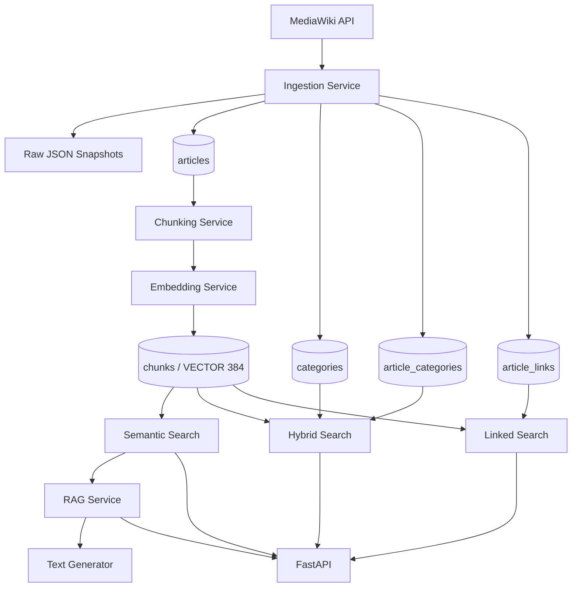

A project for area 4, "Vector search and RAG, natively" for the [MariaDB student database projects, 2026-09](https://mariadb.org/bachelor_hackathon_2026-09/).

# MVF — MariaDB Vector Finder

MVF is a MariaDB-native vector search and Retrieval-Augmented Generation (RAG) system built around a reproducible Wikipedia corpus.

The project explores how semantic retrieval, relational filtering, graph-constrained search, and RAG can be implemented while keeping vector storage, similarity computation, indexing, and query planning inside MariaDB.

MariaDB is used as an active retrieval engine rather than only as an application datastore. MVF directly uses:

```sql
VECTOR(384)
VECTOR INDEX
VEC_FromText(...)
VEC_DISTANCE_COSINE(...)
```

The current corpus contains:

- **285 Wikipedia articles**
- **3,940 vector chunks**
- **2,710 directed local article links**
- **40 manually prepared retrieval-evaluation questions**

On the current corpus, MariaDB's native vector index provides an observed **177.92× speedup** over brute-force cosine search for the benchmark query.

---

## Key Features

- MariaDB-native `VECTOR(384)` storage
- Native cosine `VECTOR INDEX`
- Semantic vector search
- Relationally filtered hybrid search
- Graph-constrained vector search through Wikipedia links
- Retrieval-Augmented Generation
- FastAPI backend
- Async SQLAlchemy database access
- Reproducible Wikipedia ingestion through the MediaWiki API
- Deterministic token-based chunking
- Incremental and self-healing vector indexing
- Raw Wikipedia snapshots
- MariaDB `EXPLAIN` integration
- Search timing diagnostics
- Recall@K and MRR evaluation
- Exact article-level retrieval evaluation
- Vector-index vs brute-force benchmarks
- Ruff, mypy, and pytest quality checks
- Reproducible clean-database GitHub Actions CI

---

# Team

MVF was developed as a Constructor University database project for the
MariaDB student database projects, 2026-09.

- **Vasif Ismayilov** — backend architecture, MariaDB schema design,
  vector search, ingestion pipeline, RAG integration, benchmarking,
  retrieval evaluation
- **Mina Elif Varli** — frontend implementation and API integration
- **Fidan Mammadova** — database experiments and evaluation support

# Architecture



MVF intentionally separates corpus ingestion from vector indexing.

### Stage 1 — Corpus ingestion

```text
MediaWiki API
      ↓
articles
categories
article_categories
article_links
raw JSON snapshots
```

### Stage 2 — Vector indexing

```text
articles.content
      ↓
token-based chunking
      ↓
sentence-transformers
      ↓
384-dimensional embeddings
      ↓
MariaDB VECTOR(384)
      ↓
VECTOR INDEX
```

This two-stage design allows the corpus to be re-indexed without downloading the source data again.

---

# Technology Stack

```text
Python 3.12+
FastAPI
SQLAlchemy Async
asyncmy
MariaDB 11.8
Pydantic v2
httpx
sentence-transformers
Docker Compose
pytest
pytest-asyncio
Ruff
mypy
```

The project has been developed and verified against MariaDB **11.8.9**.

---

# Database Model

MVF combines relational metadata, article relationships, and native vectors inside one MariaDB database.

## `articles`

Stores Wikipedia article metadata and source text, including Wikipedia page ID, revision ID, title, URL, summary, full content, word count, and timestamps.

## `categories`

Stores unique Wikipedia category names.

## `article_categories`

Many-to-many relation between articles and categories. This relation is used by hybrid vector search.

## `article_links`

Stores directed links between articles that are both present in the local MVF corpus.

```text
source article
      ↓
article_links
      ↓
target article
```

Links to Wikipedia pages outside the local corpus are intentionally excluded, so the table represents the directed graph induced by the locally ingested articles.

## `chunks`

Stores token-based article chunks and their native MariaDB embeddings.

```sql
embedding VECTOR(384) NOT NULL
```

Each article has a unique `(article_id, chunk_index)` pair.

The vector index is created with cosine distance:

```sql
CREATE VECTOR INDEX IF NOT EXISTS ix_chunks_embedding
ON chunks (embedding)
M = 8
DISTANCE = cosine;
```

---

# Schema Design Rationale

MVF separates source documents, relational metadata, graph relationships, and
retrievable vector units according to how each type of data is queried.

## `articles` and `chunks`

Article-level metadata and complete source text are stored in `articles`, while
semantic retrieval operates on `chunks`.

This avoids repeating article metadata for every vector and keeps the
retrievable unit aligned with the exact text represented by the embedding.

Each chunk stores:

```text
article_id
chunk_index
content
token_count
embedding
```

The `(article_id, chunk_index)` uniqueness constraint gives every chunk a
deterministic identity within its article.

## Normalized category model

Categories are represented through:

```text
categories
article_categories
```

rather than being embedded as JSON or duplicated on every chunk.

This normalized design lets MariaDB use ordinary relational indexes and joins
for category filtering and makes hybrid search a true relational/vector query
instead of application-side post-filtering.

## Materialized local article graph

Wikipedia links are stored in `article_links` as directed relationships between
articles that exist in the local corpus.

This lets graph-constrained semantic search remain inside MariaDB using normal
joins before vector ranking.

Links to pages outside the local corpus are intentionally excluded because
those pages do not have local article rows or vector representations.

## Embeddings belong to chunks

Embeddings are stored directly in `chunks` rather than in a separate generic
vector table.

The embedding represents the chunk itself, so keeping both together avoids an
extra join in the hot semantic-search path and keeps the vector index attached
to the exact retrievable entity.

## Why relational and vector data share one database

The schema is intentionally designed so relational metadata and vector data can
participate in the same SQL statement.

That is essential for MVF's hybrid and linked retrieval modes and is the main
reason MariaDB is used as the retrieval engine rather than only as a metadata
store.

---

# Embedding Configuration

MVF currently uses:

```text
Model:                 sentence-transformers/all-MiniLM-L6-v2
Embedding dimensions:  384
Chunk size:            220 tokens
Chunk overlap:         40 tokens
Embedding normalization: L2 normalized
Vector distance:       cosine
```

Chunking uses the tokenizer associated with the embedding model rather than approximate character-based splitting.

---

# Design Decisions

## Why `all-MiniLM-L6-v2`

MVF uses `sentence-transformers/all-MiniLM-L6-v2` as a practical local
embedding model for the project corpus.

Its 384-dimensional output keeps vector storage compact and maps directly to
MariaDB:

```sql
VECTOR(384)
```

The model is small enough for reproducible local indexing while still
providing useful semantic retrieval quality on the current Wikipedia corpus.

The embedding model is deliberately kept outside MariaDB. MariaDB is
responsible for storing embeddings, indexing them, evaluating similarity,
combining vector ranking with relational constraints, and exposing execution
plans and timings.

## Why 384 dimensions

The embedding dimensionality is dictated by the selected model and is kept
unchanged throughout the pipeline.

Using the model's native 384-dimensional representation avoids lossy
projection and maps directly to:

```sql
VECTOR(384)
```

This keeps the schema explicit and guarantees that ingestion, indexing,
querying, and evaluation all operate on the same vector shape.

## Why 220-token chunks

Semantic retrieval operates on chunks rather than whole Wikipedia articles.

A chunk size of 220 model tokens was chosen as a practical balance between
retrieval granularity and semantic context. Larger chunks reduce precision by
mixing more topics into each retrievable unit, while very small chunks increase
the vector count and risk removing context needed to answer conceptual
questions.

Chunking is based on the tokenizer of the embedding model rather than
approximate character counts.

## Why 40-token overlap

Adjacent chunks overlap by 40 model tokens.

The overlap reduces the risk that information crossing a chunk boundary is
split into two unrelated retrieval units while keeping duplication moderate.
The overlap is intentionally smaller than the chunk size so neighboring chunks
retain continuity without becoming near-duplicates.

## Why cosine distance

MVF stores L2-normalized embeddings and evaluates semantic similarity with
cosine distance:

```sql
VEC_DISTANCE_COSINE(...)
```

The MariaDB vector index therefore uses the same metric:

```sql
DISTANCE = cosine
```

Using the same distance definition for indexed retrieval, brute-force
comparison, and evaluation keeps the benchmark directly interpretable.

## Why `M = 8`

The production MariaDB vector index uses:

```sql
M = 8
```

This value is backed by a controlled parameter study over:

```text
M = 4, 8, 16, 32
```

using the complete 40-question ground-truth evaluation.

All tested values produced the same retrieval quality:

```text
Recall@1  = 67.5%
Recall@3  = 87.5%
Recall@5  = 87.5%
Recall@10 = 92.5%
MRR       = 0.782
```

However, index-build cost increased substantially:

```text
M=4   -> 156 ms
M=8   -> 309 ms
M=16  -> 1.01 s
M=32  -> 3.74 s
```

`M = 8` is therefore retained as the production baseline: increasing
connectivity did not improve retrieval quality on the current corpus, while
larger values made index construction significantly more expensive.

This is a corpus-specific engineering decision rather than a claim that
`M = 8` is universally optimal.

## Why Wikipedia

English Wikipedia provides a reproducible public source with useful relational
structure in addition to article text:

- stable page identifiers;
- article categories;
- directed article-to-article links;
- enough natural language to evaluate semantic retrieval.

That makes it possible to demonstrate three different MariaDB retrieval
strategies on one corpus:

- global semantic vector search;
- category-constrained hybrid search;
- graph-constrained linked search.

## Why the hybrid filter is inside the vector subquery

The category restriction is applied inside the vector candidate query rather
than after top-k retrieval.

Applying the filter after global top-k retrieval could return fewer than the
requested number of category-matching results and would rank candidates from
the wrong search space.

The current query shape lets MariaDB optimize the filtered candidate set before
the final top-k is returned.

## Why linked search remains relational-first

Linked search was tested with both the original relational-first plan and a
vector-first derived-table rewrite.

The vector-first rewrite did not improve the measured workload, while the
relational-first plan efficiently reduced the candidate set through
`article_links` and `ix_chunks_article_id`.

The production linked query therefore intentionally keeps the relational-first
shape instead of forcing the vector index where it is not the cheapest plan.

---

# MariaDB-Native Semantic Search

The embedding for the user's query is generated in Python. The vector retrieval itself is executed by MariaDB.

```sql
SELECT
    c.chunk_id,
    c.article_id,
    a.title AS article_title,
    c.chunk_index,
    c.content,
    c.token_count,
    c.distance
FROM (
    SELECT
        id AS chunk_id,
        article_id,
        chunk_index,
        content,
        token_count,
        VEC_DISTANCE_COSINE(
            embedding,
            VEC_FromText(:embedding)
        ) AS distance
    FROM chunks
    ORDER BY distance ASC
    LIMIT :limit
) AS c
INNER JOIN articles AS a
    ON a.id = c.article_id
ORDER BY c.distance ASC;
```

MariaDB therefore handles vector storage, vector indexing, cosine-distance evaluation, ranking, limiting, and query optimization.

MariaDB-specific vector SQL is centralized in:

```text
backend/app/db/queries/vector.py
```

Normal relational persistence is separated into repository classes.

---

# Search Strategies

## Semantic Search

Global nearest-neighbor search over article chunks:

```text
query
  ↓
embedding
  ↓
VECTOR INDEX
  ↓
nearest chunks
```

For the current corpus, MariaDB selects `ix_chunks_embedding`.

## Hybrid Search

Hybrid search combines a relational category constraint with semantic vector ranking.

The category restriction is placed inside the vector candidate query so the
database can optimize the filtered top-k directly:

```sql
SELECT
    c.chunk_id,
    c.article_id,
    a.title AS article_title,
    c.chunk_index,
    c.content,
    c.token_count,
    c.distance
FROM (
    SELECT
        id AS chunk_id,
        article_id,
        chunk_index,
        content,
        token_count,
        VEC_DISTANCE_COSINE(
            embedding,
            VEC_FromText(:embedding)
        ) AS distance
    FROM chunks
    WHERE article_id IN (
        SELECT ac.article_id
        FROM article_categories AS ac
        INNER JOIN categories AS cat
            ON cat.id = ac.category_id
        WHERE cat.name = :category
    )
    ORDER BY distance ASC
    LIMIT :limit
) AS c
INNER JOIN articles AS a
    ON a.id = c.article_id
ORDER BY c.distance ASC;
```

For the benchmark category `Machine learning`, this shape uses
`ix_chunks_embedding` and reduces mean database latency from roughly **227 ms**
for the previous relational-first form to **2.359 ms**, while preserving the
checked top-k results.

For smaller filtered candidate sets, MariaDB may still prefer
`ix_chunks_article_id`, which can be cheaper.


## Linked Search

Linked search combines Wikipedia's directed article graph with semantic vector ranking:

```text
source article
      ↓
article_links
      ↓
target articles
      ↓
target chunks
      ↓
cosine ranking
```

The query combines relational joins, graph constraints, and vector similarity inside MariaDB.

A vector-first derived-table rewrite was benchmarked separately and did not improve this workload (approximately 87.4 ms current vs. 88.4 ms proposed). The production linked query therefore intentionally remains relational-first and uses `ix_chunks_article_id`.

---

# Why MariaDB-Native Retrieval

MVF intentionally keeps vector retrieval in MariaDB instead of storing
relational data in MariaDB and querying a separate vector database.

The same server can combine:

```text
relational article metadata
category membership
directed article links
native vectors
```

inside individual SQL statements.

For semantic search, MariaDB performs native nearest-neighbor ranking through
the vector index.

For hybrid search, a relational category constraint and vector ranking are
combined in one query.

For linked search, relational joins restrict the graph-constrained candidate
set before cosine ranking.

This design avoids application-side synchronization between a relational
database and a separate vector store. It also lets MariaDB's optimizer decide
when the vector index or a relational index is cheaper.

The optimizer experiments in this repository show why that matters: semantic,
hybrid, and linked retrieval do not all benefit from the same execution plan.

---

# Optimizer Statistics

Bulk ingestion and vector indexing materially change table cardinalities. MVF
therefore refreshes MariaDB optimizer statistics after both data-loading
workflows:

```sql
ANALYZE TABLE
    articles,
    chunks,
    article_categories,
    categories,
    article_links;
```

The maintenance logic is centralized in:

```text
backend/app/db/maintenance.py
```

and is called after the main work in:

```text
scripts/ingest.py
scripts/build_embeddings.py
```

This keeps optimizer decisions reproducible after corpus growth or vector
rebuilds.

---

# RAG

MVF implements Retrieval-Augmented Generation on top of MariaDB semantic retrieval.

```text
question
   ↓
EmbeddingService
   ↓
MariaDB retrieval
   ↓
retrieved chunks
   ↓
grounded prompt
   ↓
text generator
   ↓
answer + sources
```

Generation is optional. If no OpenAI API key is configured, the application can still run and retrieval endpoints remain available.

The RAG layer is deliberately separated from retrieval so retrieval latency and retrieval quality can be evaluated independently of generation time.

---

# Query Transparency

Search responses expose diagnostic information so MariaDB behavior is visible rather than hidden behind the application layer.

Debug information includes:

- executed SQL
- query parameters
- embedding latency
- database search latency
- `EXPLAIN` latency
- total retrieval latency
- MariaDB execution plan

---

# Current Dataset

| Metric | Value |
|---|---:|
| Wikipedia articles | 285 |
| Vector chunks | 3,940 |
| Directed local article links | 2,710 |
| Embedding dimensions | 384 |
| Ground-truth questions | 40 |
| Articles without chunks | 0 |

The corpus is currently centered on Wikipedia's machine-learning category.

---

# Benchmark Methodology

Performance measurements are designed to isolate database retrieval rather than
embedding generation.

Unless an experiment states otherwise:

- the query embedding is generated before database timing starts;
- the same embedding is reused when comparing query variants;
- all variants run against the same MariaDB instance and corpus;
- 5 warm-up executions are performed before measurement;
- 50 measured executions are collected;
- mean, median, and P95 latency are reported;
- the result limit is fixed at 5 for the main benchmark;
- the benchmark query is `neural network training`;
- optimizer statistics are refreshed after bulk ingestion and indexing;
- indexed and brute-force searches use the same cosine-distance definition.

The vector-index vs brute-force benchmark compares database execution
strategies rather than end-to-end API latency.

Retrieval quality is evaluated separately with 40 manually prepared
ground-truth questions using Recall@K and MRR.

Machine-readable benchmark results are stored under:

```text
experiments/results/
```

---

# Performance

Benchmarks below measure database retrieval latency. Query-embedding generation is performed before the timed database operation.

Current benchmark configuration:

```text
Corpus:         285 articles / 3,940 vectors
Query:          neural network training
Result limit:   5
Warm-up runs:   5
Measured runs:  50
```

## Search Strategy Benchmark

| Strategy | Mean | Median | P95 | Main retrieval index |
|---|---:|---:|---:|---|
| Semantic | **1.393 ms** | 1.304 ms | 1.816 ms | `ix_chunks_embedding` |
| Hybrid | **2.359 ms** | 2.238 ms | 3.017 ms | `ix_chunks_embedding` |
| Linked | 87.914 ms | 87.590 ms | 89.727 ms | `ix_chunks_article_id` |

Semantic and hybrid retrieval use the native vector index for the benchmark
workload. Linked search remains relational-first because its graph constraint
creates a different candidate set and the measured alternative plan was not
faster.

The latest machine-readable strategy result is stored in:

```text
experiments/results/search_strategies.json
```


---

# VECTOR INDEX vs Brute Force

| Mode | Mean | P95 |
|---|---:|---:|
| MariaDB `VECTOR INDEX` | **1.302 ms** | 1.688 ms |
| Brute-force cosine search | 231.728 ms | 236.068 ms |

Measured speedup:

```text
177.92×
```

At approximately four thousand vectors, native MariaDB vector indexing is
already dramatically faster than evaluating cosine distance against the full
vector table.

Current benchmark artifact:

```text
experiments/results/index_vs_bruteforce_20261013T155049Z.json
```


---

# VECTOR INDEX `M` Parameter Study

MVF evaluates MariaDB's native vector-index connectivity parameter `M` on the
full 40-question ground-truth set.

For every tested value, the vector index is rebuilt from the same 3,940-vector
corpus. Query embeddings are precomputed once, the same 200-chunk candidate
pool is used for every run, and retrieval quality is measured with the same
Recall@K and MRR methodology as the production evaluation.

| M | Index build | Mean query | Median query | P95 query | Recall@10 | MRR |
|---:|---:|---:|---:|---:|---:|---:|
| 4 | 156.482 ms | 16.056 ms | 16.074 ms | 16.785 ms | 92.5% | 0.782 |
| **8** | **309.248 ms** | **15.363 ms** | **14.854 ms** | 17.062 ms | **92.5%** | **0.782** |
| 16 | 1009.647 ms | 15.569 ms | 15.456 ms | 17.177 ms | 92.5% | 0.782 |
| 32 | 3739.729 ms | 15.205 ms | 14.882 ms | 16.147 ms | 92.5% | 0.782 |

Retrieval quality was identical for all tested `M` values:

```text
Recall@1  = 67.5%
Recall@3  = 87.5%
Recall@5  = 87.5%
Recall@10 = 92.5%
MRR       = 0.782
Misses@10 = 3 / 40
```

Increasing `M` therefore did not improve retrieval quality on the current
corpus, while vector-index construction became substantially more expensive.

`M = 8` remains the production configuration because it preserves the same
measured retrieval quality as larger values, keeps index construction much
cheaper than `M = 16` or `M = 32`, and provides competitive query latency.

The result does not claim that `M = 8` is universally optimal. It is the
measured trade-off chosen for this corpus and workload.

Machine-readable experiment artifacts:

```text
experiments/results/vector_index_m_sweep_20261014T122949Z.json
experiments/results/vector_index_m_ground_truth_20261014T123645Z.json
```


---

# Scaling Observation

| Corpus | Vectors | Semantic Mean | VECTOR INDEX Speedup |
|---|---:|---:|---:|
| 100 articles | 1,426 | ~1.94 ms | ~47× |
| 285 articles | 3,940 | ~1.39 ms | ~178× |

As the corpus grew, indexed semantic latency increased only modestly while brute-force search became substantially more expensive.

---

# Retrieval Quality

The production retrieval evaluation uses 40 manually prepared conceptual and
paraphrased questions and exercises the same MariaDB vector-index path used by
semantic search.

| Metric | Result |
|---|---:|
| Recall@1 | **67.5%** |
| Recall@3 | **87.5%** |
| Recall@5 | **87.5%** |
| Recall@10 | **95.0%** |
| MRR | **0.784** |
| Misses@10 | **2 / 40** |

Ground truth is stored in:

```text
data/ground_truth/questions.jsonl
```

Current production-evaluation artifact:

```text
experiments/results/recall_20261013T155054Z.json
```


---

# Exact Article-Level Evaluation

MVF also implements an exhaustive article-level reference evaluation. Each
article receives the distance of its closest chunk:

```sql
MIN(
    VEC_DISTANCE_COSINE(
        c.embedding,
        VEC_FromText(:embedding)
    )
)
```

The exact reference produces:

```text
Recall@1  = 67.5%
Recall@3  = 87.5%
Recall@5  = 87.5%
Recall@10 = 92.5%
MRR       = 0.782
Misses@10 = 3 / 40
```

The production vector-index path and the exhaustive article-level reference are
reported separately because they evaluate different retrieval paths and may
differ slightly around the cutoff. In the current run,
`Fine-tuning (deep learning)` is rank 10 in production retrieval and rank 11 in
the exhaustive article-level ranking.

Current exact-evaluation artifact:

```text
experiments/results/article_recall_20261013T155110Z.json
```


---

# Incremental Vector Indexing

The vector-indexing pipeline is incremental and self-healing.

Possible outcomes include:

```text
INDEXED
REBUILT
SKIPPED
EMPTY
CLEARED
```

After expanding the corpus from 100 to 285 articles:

```text
Articles scanned:  285
Indexed now:       185
Rebuilt:           0
Already valid:     100
Empty articles:    0
Stale cleared:     0
Chunks written:    2514
```

Immediately running the indexing pipeline again produced:

```text
Articles scanned:  285
Indexed now:       0
Rebuilt:           0
Already valid:     285
Empty articles:    0
Stale cleared:     0
Chunks written:    0
```

---

# Repository Structure

```text
mvf-databases-cu/
├── .github/
│   └── workflows/
│       └── ci.yml
├── backend/
│   └── app/
│       ├── api/
│       │   ├── routes/
│       │   ├── dependencies.py
│       │   ├── router.py
│       │   └── schemas.py
│       ├── clients/
│       ├── core/
│       ├── db/
│       │   ├── models/
│       │   ├── queries/
│       │   ├── repositories/
│       │   └── maintenance.py
│       ├── generators/
│       ├── services/
│       └── main.py
├── data/
│   ├── ground_truth/
│   ├── processed/
│   └── raw/
├── database/
│   └── schema/
│       ├── 001_schema.sql
│       └── 002_vector_index.sql
├── docs/
│   └── API.md
├── experiments/
│   ├── results/
│   ├── article_recall.py
│   ├── diagnose_misses.py
│   ├── explain.py
│   ├── index_vs_bruteforce.py
│   ├── latency.py
│   ├── linked_optimizer_probe.py
│   ├── recall.py
│   ├── search_strategies.py
│   ├── vector_index_m_ground_truth.py
│   └── vector_index_m_sweep.py
├── scripts/
├── tests/
│   ├── fixtures/
│   │   └── ci_seed.sql
│   ├── integration/
│   └── unit/
├── .env.example
├── .gitignore
├── docker-compose.yml
├── Makefile
├── pyproject.toml
└── README.md
```

---

# Local Setup

## 1. Clone

```bash
git clone <repository-url>
cd mvf-databases-cu
```

## 2. Create a virtual environment

```bash
python3 -m venv .venv
source .venv/bin/activate
```

## 3. Install

```bash
make install-dev
```

Equivalent:

```bash
python3 -m pip install -e ".[dev]"
```

## 4. Configure environment

```bash
cp .env.example .env
```

Update the database password and optional OpenAI configuration if required.

## 5. Start MariaDB

```bash
make db-up
```

## 6. Apply schema

```bash
make db-init
```

## 7. Verify MariaDB

```bash
make db-verify
```

Expected output includes:

```text
MariaDB version: 11.8.x
Tables: articles, article_categories, article_links, categories, chunks
Chunk embedding type: vector(384)
```

---

# Build the Corpus

```bash
make ingest
```

Equivalent:

```bash
python3 -m scripts.ingest \
  --category "Machine learning" \
  --limit 300 \
  --concurrency 5
```

MediaWiki may return fewer pages than the requested maximum. The current ingestion produced 285 stored articles.

---

# Build Vector Embeddings

```bash
make index
```

Force a complete rebuild:

```bash
make index-force
```

---

# Run the API

```bash
make api
```

Equivalent:

```bash
uvicorn backend.app.main:app \
  --host 0.0.0.0 \
  --port 8000 \
  --reload
```

API:

```text
http://localhost:8000
```

Interactive OpenAPI documentation:

```text
http://localhost:8000/docs
```

Health endpoint:

```text
GET http://localhost:8000/health
```

For the exact frontend-facing contract, see [`docs/API.md`](docs/API.md).

---

# Experiments

Main benchmark:

```bash
make benchmark
```

Retrieval quality:

```bash
make recall
```

Exact article-level retrieval:

```bash
make article-recall
```

Difficult-query diagnostics:

```bash
python3 -m experiments.diagnose_misses
```

Vector-index `M` single-query probe:

```bash
python3 -m experiments.vector_index_m_sweep
```

Full 40-question `M` parameter evaluation:

```bash
python3 -m experiments.vector_index_m_ground_truth
```

Both `M` experiments restore the production vector index to `M = 8` after
completion.

Experiment results are written under:

```text
experiments/results/
```

---

# Code Quality

Run all checks:

```bash
make quality
```

The quality gate runs:

```bash
ruff check backend scripts tests experiments
ruff format --check backend scripts tests experiments
mypy backend scripts experiments tests
pytest -v
```

The current local quality gate is green: Ruff passes, mypy passes, and **27 / 27 automated tests** pass. The suite covers API integration, semantic/hybrid/linked retrieval, RAG behavior, chunking, and embedding behavior.

The same quality gate is executed automatically on GitHub Actions for pushes
and pull requests to `main`.

The CI environment starts a clean MariaDB 11.8 service, applies the project
schema and native vector index, loads a deterministic integration-test fixture,
and then runs:

```text
Ruff linting
Ruff formatting check
mypy
pytest
```

The integration suite therefore does not depend on a developer's pre-existing
local database contents.

The development dependency for Ruff is pinned so local formatting and CI
formatting use the same formatter version.


---

# Useful Make Commands

```text
make install-dev     Install project and development dependencies
make db-up           Start MariaDB
make db-down         Stop MariaDB
make db-reset        Recreate the MariaDB Docker volume
make db-init         Apply schema and vector index
make db-verify       Verify MariaDB setup
make ingest          Ingest Wikipedia corpus
make index           Incrementally build embeddings
make index-force     Force vector rebuild
make api             Run FastAPI
make test            Run pytest
make lint            Run Ruff
make format          Format source files
make typecheck       Run mypy
make quality         Run complete quality gate
make benchmark       Run main search benchmarks
make recall          Run retrieval evaluation
make article-recall  Run exact article-level evaluation
make clean           Remove local Python caches
```

---

# Reproducibility

Important retrieval parameters are fixed and documented:

```text
MariaDB version
embedding model
embedding dimensionality
chunk size
chunk overlap
vector distance metric
vector-index configuration
corpus size
benchmark warm-ups
benchmark runs
ground-truth questions
CI integration-test fixture
```

Raw Wikipedia snapshots are preserved separately from vector generation, and experiment outputs are stored as machine-readable JSON.

Dataset and retrieval configuration metadata is also summarized in:

```text
data/manifest.json
```

The manifest records the corpus size, embedding model and dimensions, chunking
configuration, vector-index configuration, distance metric, and MariaDB version.


---

# Current Limitations

The corpus is focused on machine-learning-related Wikipedia articles rather than general web search.

The lightweight `all-MiniLM-L6-v2` embedding model does not produce perfect ranking for every semantic query. Current production Recall@10 is **95.0%**; the exhaustive article-level reference reaches **92.5%** at the same cutoff.

Hybrid search now uses the native vector index efficiently for the benchmark category. Linked graph-constrained search remains relational-first because controlled optimizer experiments showed that this is the cheaper plan for that candidate set.

These behaviors are measured and documented rather than hidden because optimizer behavior and retrieval trade-offs are central to the project.

---

# Future Work

Potential extensions include:

- larger corpus experiments
- additional embedding-model comparisons
- lexical + vector fusion
- reranking
- query expansion
- deeper graph traversal
- larger human-reviewed ground truth
- frontend visualization of SQL, timings, and `EXPLAIN`
- generation-latency instrumentation
- complete application containerization

---

# Project Status

The backend currently provides:

```text
Wikipedia ingestion
incremental vector indexing
semantic search
hybrid search
linked search
RAG
catalog APIs
MariaDB EXPLAIN diagnostics
latency benchmarking
index-vs-brute-force benchmarking
VECTOR INDEX M-parameter evaluation
retrieval evaluation
exact article-level evaluation
integration and unit tests
```

The MariaDB retrieval layer has been validated with query-plan inspection, optimizer-statistics refresh, performance benchmarking, retrieval evaluation, and automated regression tests. The next stage is frontend integration and final end-to-end application validation.
