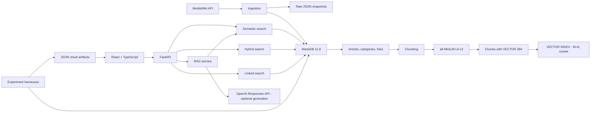

A project for area 4, "Vector search and RAG, natively" for the [MariaDB student database projects, 2026-09](https://mariadb.org/bachelor_hackathon_2026-09/).

# MVF — MariaDB Vector Finder

**MVF** is a full-stack MariaDB-native vector search and Retrieval-Augmented Generation (RAG) application over a reproducible Wikipedia corpus.

It keeps **vector storage, cosine similarity, ANN indexing, relational filtering, graph constraints, query planning, and retrieval diagnostics inside MariaDB**. A React frontend makes the database behavior visible: users can ask grounded questions, inspect retrieved chunks, run hybrid/category and linked-article searches, view the exact SQL, and inspect MariaDB `EXPLAIN` plans.


## What the project demonstrates

MVF directly exercises the Area 4 capability rather than treating MariaDB as a passive metadata store:

- native `VECTOR(384)` storage;
- native cosine `VECTOR INDEX`;
- `VEC_FromText(...)` and `VEC_DISTANCE_COSINE(...)`;
- semantic nearest-neighbor retrieval;
- vector search combined with ordinary relational predicates in the **same SQL statement**;
- graph-constrained retrieval through `article_links`;
- RAG over retrieved Wikipedia chunks;
- `EXPLAIN`, optimizer-statistics refresh, index-use visibility, and timing diagnostics;
- Recall@K / MRR evaluation, brute-force baselines, and vector-index parameter studies.

Current corpus:

| Metric                             |            Value |
| ---------------------------------- | ---------------: |
| Wikipedia articles                 |    **285** |
| Vector chunks                      |  **3,940** |
| Directed local article links       |  **2,710** |
| Embedding dimensions               |    **384** |
| Human-prepared retrieval questions |     **40** |
| MariaDB                            | **11.8.9** |

The embedding model is `sentence-transformers/all-MiniLM-L6-v2`; chunks are 220 model tokens with 40-token overlap and L2-normalized embeddings.

### Why this embedding model and corpus?

MVF uses `sentence-transformers/all-MiniLM-L6-v2` because it produces compact 384-dimensional sentence embeddings, runs locally without a hosted embedding API, and maps directly to MariaDB `VECTOR(384)`. That keeps ingestion reproducible and vector/index storage modest while still providing useful semantic retrieval quality for the project corpus.

The corpus is built reproducibly from the English Wikipedia `Machine learning` category through the MediaWiki API. Ingestion requests up to 300 pages (`make ingest`); the committed crawl produced **285 articles**, which are preserved as raw JSON snapshots under `data/raw/`. The project deliberately uses one coherent subject area so semantic, category-filtered, and article-link-constrained retrieval can be evaluated over the same relational corpus.

---

## Architecture



The application is deliberately layered:

- **React frontend**: query UX, filters, retrieved chunks, evaluation dashboards, SQL/plan visualization.
- **FastAPI backend**: HTTP contract and dependency wiring.
- **Services**: embedding, search, chunking, ingestion, RAG.
- **Repositories**: ordinary relational CRUD through SQLAlchemy.
- **Vector query module**: MariaDB-specific vector SQL centralized in `backend/app/db/queries/vector.py`.
- **MariaDB**: relational metadata, local link graph, vectors, ANN index, joins, ranking, filtering, and query planning.

Generation is intentionally separate from retrieval. With `OPENAI_API_KEY` configured, retrieved chunks are passed to the OpenAI Responses API for a grounded answer. Without an OpenAI key, the retrieval/search/evaluation functionality remains usable.

---

## Data model and why it is shaped this way

| Table                  | Purpose                                  | Design reason                                                                            |
| ---------------------- | ---------------------------------------- | ---------------------------------------------------------------------------------------- |
| `articles`           | Wikipedia metadata and source text       | one authoritative document row; avoids repeating metadata per vector                     |
| `categories`         | normalized category names                | supports indexed relational filtering                                                    |
| `article_categories` | article ↔ category relation             | makes hybrid retrieval a real SQL join/filter instead of post-filtering in Python        |
| `article_links`      | directed links inside the local corpus   | supports graph-constrained search entirely inside MariaDB                                |
| `chunks`             | retrievable text units + `VECTOR(384)` | keeps each embedding with the exact text it represents and avoids an extra hot-path join |

Each chunk has a deterministic `(article_id, chunk_index)` identity.

The vector column and index are native MariaDB objects:

```sql
embedding VECTOR(384) NOT NULL;
```

```sql
CREATE VECTOR INDEX IF NOT EXISTS ix_chunks_embedding
ON chunks (embedding)
M = 8
DISTANCE = cosine;
```

Relational metadata and vectors intentionally share one database so MariaDB can optimize mixed relational/vector workloads as a single query plan.

---

## Retrieval modes

### 1. Semantic vector search

The query is embedded in Python; MariaDB performs nearest-neighbor ranking:

```sql
SELECT
    c.chunk_id,
    c.article_id,
    a.title AS article_title,
    c.chunk_index,
    c.content,
    c.distance
FROM (
    SELECT
        id AS chunk_id,
        article_id,
        chunk_index,
        content,
        VEC_DISTANCE_COSINE(
            embedding,
            VEC_FromText(:embedding)
        ) AS distance
    FROM chunks
    ORDER BY distance ASC
    LIMIT :limit
) AS c
JOIN articles AS a ON a.id = c.article_id
ORDER BY c.distance ASC;
```

For the current corpus, `EXPLAIN` shows `ix_chunks_embedding` on `chunks`.


### 2. Hybrid search: vector + relational predicate

Hybrid search applies the category predicate **inside** the vector candidate query:

```sql
WHERE article_id IN (
    SELECT ac.article_id
    FROM article_categories AS ac
    JOIN categories AS cat
      ON cat.id = ac.category_id
    WHERE cat.name = :category
)
ORDER BY distance ASC
LIMIT :limit
```

This searches the correct filtered space instead of taking global top-k first and filtering afterward.


The UI exposes that the relational category index and the MariaDB vector index participate in the same plan:


### 3. Linked / graph-constrained search

Linked search starts from one Wikipedia article, follows `article_links`, reads only chunks belonging to linked target articles, and ranks those chunks by cosine distance.


This workload is intentionally **relational-first**. Controlled optimizer experiments showed that forcing a vector-first rewrite was not faster for the small graph-constrained candidate set. The production plan therefore uses relational indexes such as `ix_articles_title` and `ix_chunks_article_id` instead of forcing HNSW.


This is an important project finding: **the vector index is not automatically the cheapest plan for every vector-bearing query**.

---

## RAG user flow

1. User asks a question in the React UI.
2. `EmbeddingService` creates a 384-dimensional query vector.
3. MariaDB retrieves the closest Wikipedia chunks with native vector SQL.
4. The backend returns the chunks, SQL, timings, and `EXPLAIN` diagnostics.
5. If OpenAI generation is configured, only the retrieved context is sent to the generator.
6. The UI shows the grounded answer, citations, source articles, chunk distances, and MariaDB details.

The frontend distinguishes database retrieval time from full RAG response time, so LLM latency is not confused with MariaDB search latency.

---

## Measured results

Benchmarks isolate **database retrieval**: query embedding is computed before timing, then the same embedding is reused. The main latency harness uses **5 warm-up executions + 50 measured executions** and records mean, median, P95, and machine-readable JSON results.

### Search strategies

| Strategy |               Mean |    Median |       P95 | Main retrieval index     |
| -------- | -----------------: | --------: | --------: | ------------------------ |
| Semantic | **1.393 ms** |  1.362 ms |  1.781 ms | `ix_chunks_embedding`  |
| Hybrid   | **2.270 ms** |  2.235 ms |  2.720 ms | `ix_chunks_embedding`  |
| Linked   |          86.200 ms | 85.605 ms | 90.727 ms | `ix_chunks_article_id` |

### Native index vs brute force

| Mode                      |               Mean |        P95 |
| ------------------------- | -----------------: | ---------: |
| MariaDB `VECTOR INDEX`  | **1.302 ms** |   1.688 ms |
| Brute-force cosine search |         231.728 ms | 236.068 ms |

Observed mean speedup: **177.92×**.


### Retrieval quality

Production ANN evaluation over 40 manually prepared questions:

| Metric    |           Result |
| --------- | ---------------: |
| Recall@1  |  **67.5%** |
| Recall@3  |  **87.5%** |
| Recall@5  |  **87.5%** |
| Recall@10 |  **95.0%** |
| MRR       |  **0.784** |
| Misses@10 | **2 / 40** |

Ground truth is stored in `data/ground_truth/questions.jsonl`.

MVF also runs an exhaustive article-level reference evaluation. That path measured **92.5% Recall@10 / 0.782 MRR / 3 misses**. The two numbers are intentionally reported separately: they are different retrieval paths and can differ at the rank cutoff. In the committed run, one relevant article appears at rank 10 in the production ANN result and rank 11 in the exhaustive article-level ranking.

A later rebuilt-index `M` study also measured **92.5% Recall@10** for all tested `M` values. The takeaway is that the 95% production run should not be treated as an invariant of every ANN rebuild.

### Vector-index `M` study

|           M |       Build time |        Median query | P95 query |       Recall@10 |             MRR |
| ----------: | ---------------: | ------------------: | --------: | --------------: | --------------: |
|           4 |           156 ms |           16.074 ms | 16.785 ms |           92.5% |           0.782 |
| **8** | **309 ms** | **14.854 ms** | 17.062 ms | **92.5%** | **0.782** |
|          16 |           1.01 s |           15.456 ms | 17.177 ms |           92.5% |           0.782 |
|          32 |           3.74 s |           14.882 ms | 16.147 ms |           92.5% |           0.782 |

`M=8` remains the production choice because larger values did not improve article-level retrieval quality on this corpus while index construction became substantially more expensive.

A separate single-query exact-top-5 probe found chunk-level overlap of **0.8** for `M=4/8/16` but **0.4** for `M=32`. That result is kept as a documented ANN approximation/failure-mode observation even though the full 40-question article-level Recall@10 did not change.

### Filtered ANN probe

MVF also measures the category-filtered hybrid query with the native vector index enabled and optimizer-ignored, using the same query, category and top-k in both cases.

| Hybrid mode | Mean latency | Top-k |
|---|---:|---|
| `ix_chunks_embedding` enabled | **2.497 ms** | reference |
| Vector index optimizer-ignored | 232.818 ms | identical |

Observed mean speedup: **93.22×**, with the **same top-k** in both runs.

This directly verifies that the relational category predicate can coexist with native ANN retrieval in the same SQL statement and that the vector index is materially responsible for the measured hybrid-search speedup.

Result artifact:

```text
experiments/results/hybrid_index_probe_20261018T111312Z.json
```

### Runtime HNSW `mhnsw_ef_search` study

Build-time `M` is not the only ANN tuning surface. MVF therefore evaluates MariaDB's session-level `mhnsw_ef_search` across the complete 40-question ground-truth set. Each setting is measured in **3 complete passes** after a warm-up round, so both retrieval quality and between-pass latency variance are recorded.

| `mhnsw_ef_search` | Aggregate mean | Aggregate P95 | Between-pass stddev | Recall@10 | MRR |
|---:|---:|---:|---:|---:|---:|
| **200** | **15.523 ms** | 16.889 ms | 0.348 ms | **92.5%** | **0.782** |
| 400 | 16.088 ms | 17.614 ms | 0.228 ms | 92.5% | 0.782 |
| 800 | 15.834 ms | 17.933 ms | 0.277 ms | 92.5% | 0.782 |
| 1600 | 16.993 ms | 18.420 ms | 1.415 ms | 92.5% | 0.782 |

On this 3,940-vector corpus, raising `mhnsw_ef_search` above 200 did **not** improve Recall@10 or MRR. Query latency instead increased slightly, and the 1600 setting showed noticeably more run-to-run noise because one pass contained an outlier. This is reported rather than discarded because the experiment is intended to expose real ANN/runtime behavior, not only the cleanest run.

Result artifact:

```text
experiments/results/vector_ef_search_20261018T111327Z.json
```

Machine-readable results live in `experiments/results/`.

> **Benchmark provenance:** the older committed benchmark JSON predates environment capture, so its absolute latency should be treated as hardware-dependent. New experiment artifacts record the execution environment automatically. The current reproduced studies were run on **Darwin 24.5.0 / arm64**, **Python 3.13.0**, with **MariaDB 11.8.9-MariaDB-ubu2404** in Docker. The harness fixes corpus size, query set, warm-ups, measured passes, distance metric and index configuration.

`make environment` records OS, architecture, processor, Python and MariaDB version, and on macOS also records machine model, chip and memory when available.

The exact timestamp of the original Wikipedia crawl was not recorded, so `data/manifest.json` intentionally keeps `retrieved_at: null` instead of inventing a date. Future ingestion runs should record the timestamp at collection time.

---

## Reproduce the project

### Requirements

- Python **3.12+**
- Docker + Docker Compose
- Node.js **22+**
- MariaDB is provided by Docker (`mariadb:11.8`)
- optional: `OPENAI_API_KEY` for generated RAG answers

Local services bind to loopback by default. MariaDB uses a separate `DB_ROOT_PASSWORD`, and `make api` runs without hot reload; `make api-dev` is available for local code-reload development.

The first vector build downloads `sentence-transformers/all-MiniLM-L6-v2` if it is not already cached.

### 1. Backend and MariaDB

```bash
python3 -m venv .venv
source .venv/bin/activate
make install-dev

cp .env.example .env

make db-up
make db-init
make db-verify
```

Expected verification includes MariaDB 11.8, the five project tables, and `vector(384)` for `chunks.embedding`.

### 2. Build the reproducible Wikipedia corpus

```bash
make ingest
make index
```

The ingestion uses the MediaWiki API and preserves raw snapshots under `data/raw/`. Ingestion and vector indexing are deliberately separate, so embeddings can be rebuilt without downloading the corpus again.

### 3. Run the API

```bash
make api
```

- API: `http://localhost:8000`
- OpenAPI: `http://localhost:8000/docs`
- health: `GET /health`
- live project metadata: `GET /api/stats`

### 4. Run the frontend

```bash
cd frontend
cp .env.example .env
npm ci
npm run dev
```

`frontend/.env.example` already points `VITE_API_URL` at `http://localhost:8000`; set `VITE_USE_MOCK=true` if you want to explore the UI without a running backend.

Open the Vite URL (normally `http://localhost:5173`).

### Fast MariaDB-only demonstration

Once the database is prepared:

```bash
make demo
```

This runs semantic, hybrid, and linked retrieval and prints ranked results, the exact MariaDB SQL, parameters, timings, `EXPLAIN`, and selected indexes.

Machine-readable output:

```bash
python3 -m scripts.demo --json
```

No OpenAI key is required for this retrieval demo.

### One-command first-time bootstrap

For a fresh checkout, the complete local data/retrieval setup can also be prepared with:

```bash
make bootstrap
```

This creates missing backend/frontend environment files from the checked-in examples, installs Python and frontend development dependencies, starts and waits for MariaDB, applies the schema, ingests the Wikipedia corpus, and builds the vector index. It intentionally does not start long-running API/frontend processes; run `make api` and `make frontend` in separate terminals afterwards.

### Standalone SQL examples

[`sql/examples.sql`](sql/examples.sql) is a MariaDB-client walkthrough independent of the Python API. It uses an existing stored chunk as the query vector so the semantic, category-filtered, linked-article and `EXPLAIN` examples can be pasted directly into a prepared MVF database.

### Transactional consistency

MariaDB stores the relational article and its vector chunk in the same InnoDB transaction. `tests/integration/test_vector_transaction.py` inserts an article plus `VECTOR(384)` chunk, verifies both are visible inside the transaction, rolls the transaction back, and then verifies that neither row remains. This demonstrates the database-native consistency advantage over synchronizing a relational database with a separate vector service.

---

## User guide

**Ask**
Type a question and press **Ask**. With OpenAI configured, MVF shows the generated grounded answer, Wikipedia sources, retrieved chunks, cosine distance/similarity, and MariaDB diagnostics.

**Hybrid filter**
Open **Filters**, choose a category such as `Machine learning`, apply it, and run the query. MVF deliberately shows retrieval-only results so the relational/vector behavior is easy to inspect.

**Linked filter**
Choose **Linked from article**. MariaDB follows the local `article_links` graph and ranks only chunks belonging to linked target articles.

**MariaDB details**
Expand the details card to inspect search latency, index use, exact SQL, highlighted filter lines, and `EXPLAIN`.

**Evaluation**
Open **Evaluation** to inspect committed Recall@K/MRR, indexed-vs-brute-force latency, semantic/hybrid/linked timings, and the `M` parameter study.

---

## Additional reproducibility probes

```bash
make environment
make ef-search
make hybrid-index
```

`make environment` prints machine-readable host and MariaDB metadata. `make ef-search` evaluates MariaDB's session-level `mhnsw_ef_search` tuning surface at 200/400/800/1600 candidates over the complete 40-question ground-truth set, with three complete measured passes per setting and latency variance, then restores the production/default value (20). The current run found identical **92.5% Recall@10 / 0.782 MRR** at every setting, while aggregate mean latency rose from **15.523 ms** at 200 to **16.993 ms** at 1600. `make hybrid-index` measures the category-filtered query with `ix_chunks_embedding` enabled and optimizer-ignored; the current run measured **2.497 ms vs 232.818 ms (93.22×)** with identical top-k. These probes directly measure runtime HNSW tuning and filtered-ANN behavior rather than inferring them from a single plan row.

---

## Testing and CI

Backend quality gate:

```bash
make quality
```

It runs Ruff, formatting checks, strict mypy, and pytest. With the transactional-vector regression test included, the backend suite collects **29 automated tests**, covering API integration, semantic/hybrid/linked retrieval, RAG behavior, chunking, embedding behavior, and the guided demo.

Frontend checks:

```bash
cd frontend
npm run lint
npm test
npm run build
```

GitHub Actions starts a clean MariaDB 11.8 service, applies the schema and native vector index, loads a deterministic fixture, and runs backend quality checks. The frontend CI path installs Node dependencies and validates lint/tests/production build.

The repository keeps secrets out of source control through environment configuration; `.env.example` contains placeholders only.

---

## Repository map

```text
.
├── backend/                  FastAPI application
│   └── app/
│       ├── api/              routes, schemas, dependencies
│       ├── db/               models, repositories, vector SQL, maintenance
│       ├── generators/       optional LLM generation
│       └── services/         ingestion, chunking, embeddings, search, RAG
├── frontend/                 React + TypeScript application
├── database/schema/          MariaDB schema + VECTOR INDEX DDL
├── data/
│   ├── raw/                  reproducible Wikipedia snapshots
│   ├── ground_truth/         40-question retrieval ground truth
│   └── manifest.json         corpus/index configuration
├── experiments/              benchmark/evaluation harnesses
│   └── results/              machine-readable result JSON
├── scripts/                  ingest/index/demo/search utilities
├── sql/
│   └── examples.sql          pasteable MariaDB vector-search walkthrough
├── tests/                    backend unit/integration tests + CI fixture
├── docs/
│   ├── API.md
│   └── screenshots/
├── docker-compose.yml
├── Makefile
├── pyproject.toml
└── README.md
```

---

## Important findings and limitations

- Native MariaDB vector indexing is already ~**178× faster** than brute-force cosine ranking at 3,940 vectors for the benchmark query.
- Semantic and benchmark hybrid search use the vector index; graph-constrained linked search intentionally does not because the relational-first plan is cheaper for that candidate set.
- ANN results near a rank cutoff can change across retrieval paths/index rebuilds; MVF reports production ANN, exhaustive reference, and rebuilt-index studies separately instead of hiding the difference.
- `M=32` increased build cost substantially and reduced single-query exact top-5 chunk overlap without improving full-set article Recall@10.
- The corpus is intentionally focused on the Wikipedia machine-learning neighborhood rather than general web search.
- Absolute latency depends on host hardware/cache state; the historical benchmark artifact did not record host machine metadata.
- OpenAI is an optional generation dependency. MariaDB retrieval, diagnostics, experiments, and the guided demo do not require it.

These behaviors are part of the project result: MVF does not assume that every vector query should force the same index or that one ANN measurement is universally stable.

---

## Team

MVF was developed for the MariaDB student database projects at Constructor University.

- **Vasif Ismayilov** — backend architecture, MariaDB schema/vector design, ingestion, search/RAG integration, benchmarks, retrieval evaluation
- **Mina Elif Varli** — frontend implementation and API integration
- **Fidan Mammadova** — database experiments and evaluation support

---

## Why MariaDB for this project?

MVF could have placed relational metadata in MariaDB and embeddings in a separate vector database. It deliberately does not.

Keeping them together lets one server perform:

```text
relational metadata
+ category predicates
+ article-link graph joins
+ native vectors
+ cosine ranking
+ ANN indexing
+ EXPLAIN / optimizer decisions
```

That is the core Area 4 result: **MariaDB is not merely storing application data; it is the retrieval engine.**
